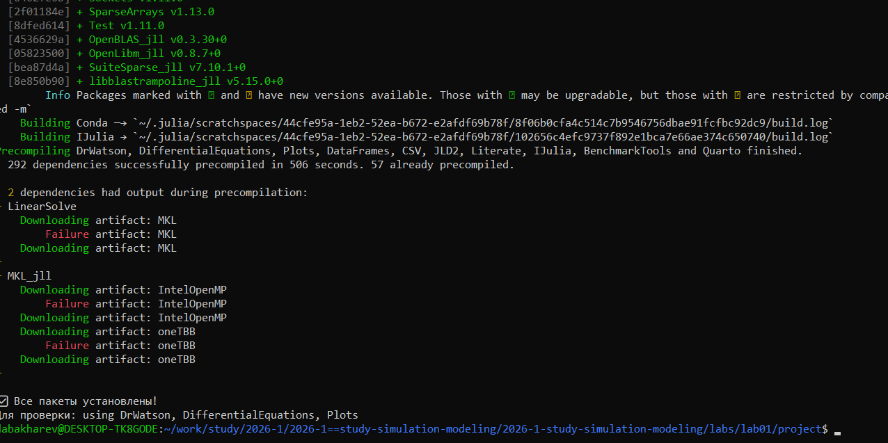
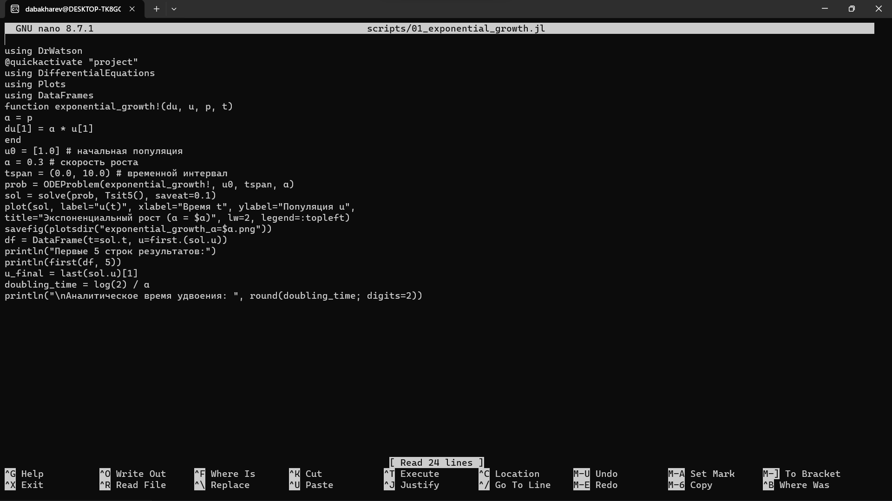
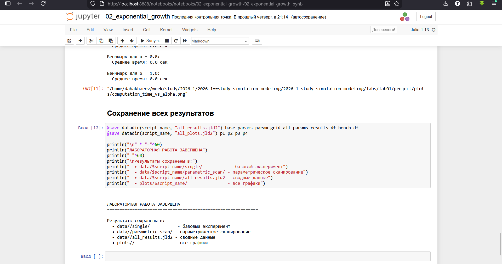

---
## Author
author:
  - name: Бахарев Дмитрий Александрович
    group: НКНбд-01-23
    email: traap.luuvv@mail.ru
    affiliation:
      - name: Российский университет дружбы народов
        country: Российская Федерация
        postal-code: 117198
        city: Москва
        address: ул. Миклухо-Маклая, д. 6
## Title
title: Лабораторная работа №1
subtitle: Подготовка стенда и модель экспоненциального роста
license: CC BY
---

# Введение

## Актуальность

- Имитационное моделирование — универсальный инструмент в естественных
  и технических науках.
- Модель экспоненциального роста — базовый пример динамической системы.
- Освоение Julia/DrWatson/Literate/Quarto необходимо для воспроизводимых
  исследований.

## Цель и задачи

**Цель:** освоить инструменты Julia/DrWatson/Literate/Quarto
и исследовать модель экспоненциального роста.

**Задачи:**

1. Создать рабочее пространство курса.
2. Установить пакеты Julia.
3. Реализовать модель экспоненциального роста.
4. Провести параметрическое исследование.
5. Собрать отчёт в формате PDF/DOCX.

# Теоретическая часть

## Модель экспоненциального роста

Уравнение:

$$\frac{du}{dt} = \alpha u, \quad u(0) = u_0.$$

Аналитическое решение:

$$u(t) = u_0 e^{\alpha t}.$$

Время удвоения:

$$T_2 = \frac{\ln 2}{\alpha}.$$

## Инструменты

| Инструмент | Назначение |
|---|---|
| Git + Gitflow | Контроль версий |
| Julia | Язык научных вычислений |
| DrWatson.jl | Организация проектов |
| Literate.jl | Литературное программирование |
| Quarto | Сборка отчётов PDF/DOCX |

# Выполнение лабораторной работы

## Создание рабочего пространства

Рабочий каталог курса создан на основе шаблона. Проект DrWatson
инициализирован в каталоге `labs/lab01/project` (рис. 1).

{width=60%}

## Установка пакетов

Пакеты Julia успешно установлены и проверены (рис. 2).

{width=60%}

## Код скриптов

Скрипт `01_exponential_growth.jl` написан в стиле литературного
программирования (рис. 3).

{width=70%}

Скрипт `02_exponential_growth.jl` реализует параметрическое исследование
(рис. 4).

{width=70%}

## Результаты: базовый случай

График численного решения для $\alpha = 0.3$ приведён на рис. 5.

{width=60%}

## Результаты: параметрическое исследование

Сравнение траекторий для разных $\alpha$ показано на рис. 6.

{width=60%}

## Jupyter-ноутбук

Jupyter-ноутбук с параметрическим исследованием выполнен (рис. 7).

{width=60%}

# Заключение

## Итоги

- Освоены Git, Gitflow, Julia, DrWatson, Literate.jl, Quarto.
- Реализована модель экспоненциального роста.
- Проведено параметрическое исследование.
- Численное решение совпадает с аналитическим.
- Отчёт собран в PDF и DOCX.

