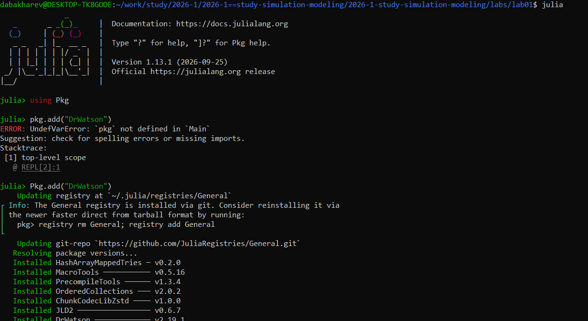
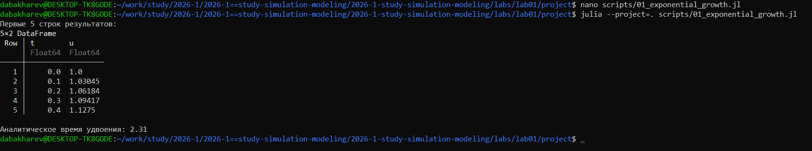
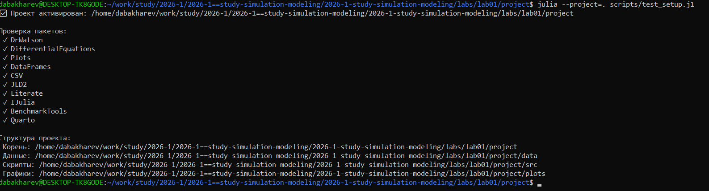
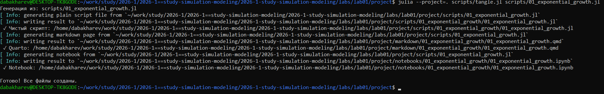
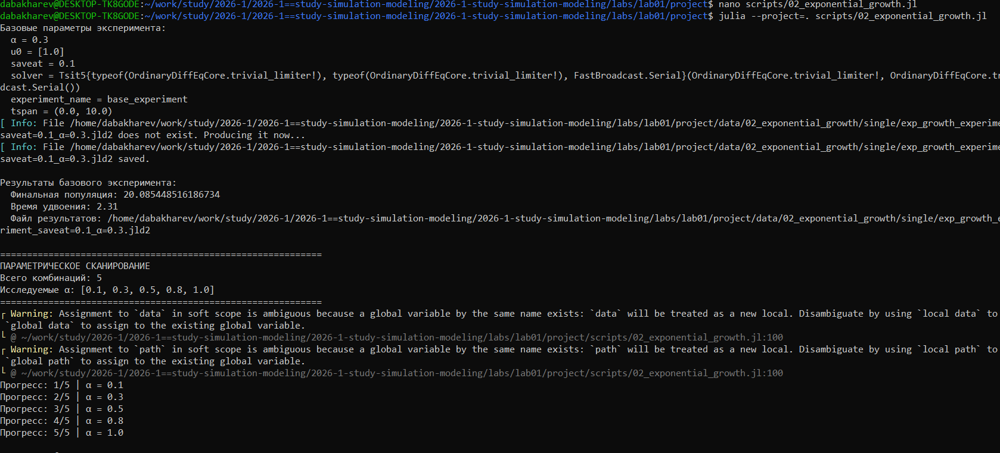
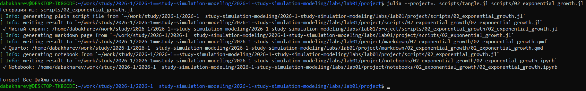

---
## Author
author:
  - name: Бахарев Дмитрий Александрович
    group: НКНбд-01-23
    email: traap.luuvv@mail.ru
    affiliation:
      - name: Российский университет дружбы народов
        country: Российская Федерация
        postal-code: 117198
        city: Москва
        address: ул. Миклухо-Маклая, д. 6
## Title
title: "Отчёт по лабораторной работе №1"
subtitle: "Имитационное моделирование"
license: "CC BY"
abstract: |
  В отчёте описана настройка рабочего пространства для курса
  «Имитационное моделирование», освоение Julia, DrWatson,
  Literate.jl и Quarto. Реализована базовая модель
  экспоненциального роста и проведено её параметрическое исследование.
keywords: [имитационное моделирование, Julia, DrWatson, экспоненциальный рост]
---

# Цель работы

Настройка рабочего пространства для курса «Имитационное моделирование»,
знакомство с языком Julia, пакетом DrWatson, системой контроля версий Git
и инструментами Literate.jl / Quarto.

# Задание

— Создать рабочий каталог для всего курса.
— Создать рабочее пространство для программ в рамках лабораторной работы.
— Выполнить все задания по тексту лабораторной работы.
— Установить необходимые пакеты.
— Выполнить предложенный код.
— Преобразовать код в литературный стиль.
— Сгенерировать из литературного кода:
  — чистый код;
  — jupyter notebook;
  — документацию в формате Quarto.
— Выполнить код из jupyter notebook.
— Интегрировать документацию в формате Quarto в отчёт.
— Добавить в код в литературном стиле вычисление для набора параметров.
— Сгенерировать из литературного кода с параметрами:
  — чистый код;
  — jupyter notebook;
  — документацию в формате Quarto.
— Выполнить код из jupyter notebook с параметрами.
— Интегрировать документацию с параметрами в формате Quarto в отчёт.

# Теоретическое введение

Экспоненциальный рост описывается уравнением `du/dt = α·u`, где `u(t)` — текущее значение величины, `α` — константа роста. Решение: `u(t) = u₀·e^(αt)`. Время удвоения: `T₂ = ln(2)/α`.

Для работы с моделью используется пакет DrWatson (организация проекта), Literate.jl (литературное программирование) и Quarto (сборка отчётов).

# Выполнение лабораторной работы

## Создание рабочего пространства

Проверяю установку Julia и создаю DrWatson-проект в каталоге `labs/lab01/project` (рис. @fig-1).

{#fig-1 width=70%}

## Установка пакетов

Устанавливаю пакеты DifferentialEquations, Plots, DataFrames, Literate, IJulia, JLD2, BenchmarkTools (рис. @fig-2).

{#fig-2 width=70%}

## Базовая модель

Создаю скрипт `01_exponential_growth.jl` и запускаю его (рис. @fig-3).

{#fig-3 width=70%}

График экспоненциального роста (рис. @fig-4):

{#fig-4 width=70%}

## Параметрическое исследование

Скрипт `02_exponential_growth.jl` сканирует параметр α по значениям {0.1, 0.3, 0.5, 0.8, 1.0} (рис. @fig-5).

{#fig-5 width=70%}

Сводная таблица результатов:

| α | Финальная популяция | Время удвоения |
|---|---|---|
| 0.1 | 3.21 | 6.93 |
| 0.3 | 20.09 | 2.31 |
| 0.5 | 148.41 | 1.39 |
| 0.8 | 2981.0 | 0.87 |
| 1.0 | 22026.5 | 0.69 |

## Генерация производных форматов

Запускаю `tangle.jl` — генерируются `.qmd`, `.ipynb`, `.jl` (рис. @fig-6).

{#fig-6 width=70%}

## Jupyter-ноутбуки

Jupyter-ноутбук `01_exponential_growth.ipynb` выполнен без ошибок (рис. @fig-7).

{#fig-7 width=70%}

## Листинги из Julia





# Заключение

В ходе лабораторной работы №1:

- Создано рабочее пространство для курса.
- Освоены Julia, DrWatson, Literate.jl, Quarto.
- Реализована базовая модель экспоненциального роста.
- Проведено параметрическое исследование по α.
- Сгенерированы `.jl`, `.qmd`, `.ipynb`.
- Отчёт собран в PDF и DOCX.

# Список литературы {.unnumbered}

::: {#refs}
:::
