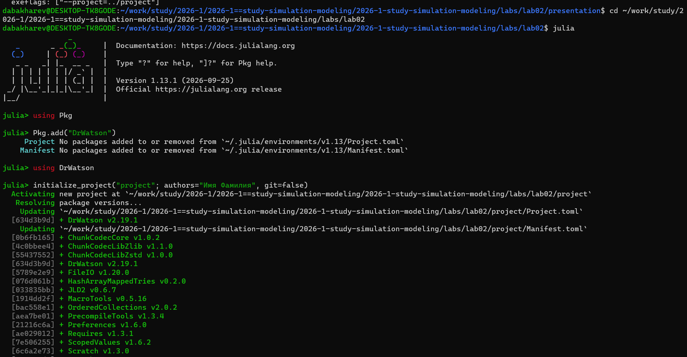
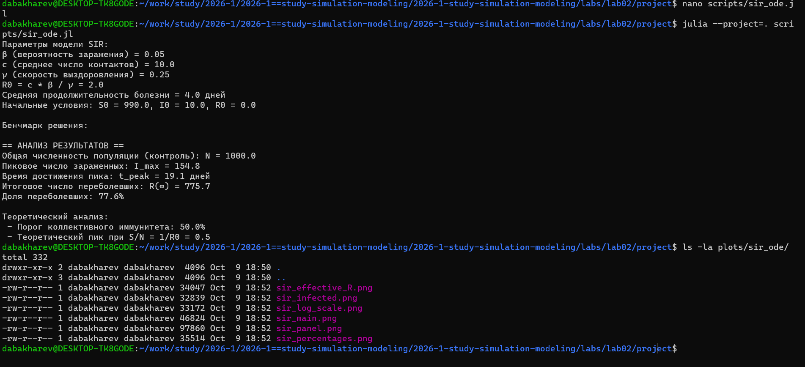
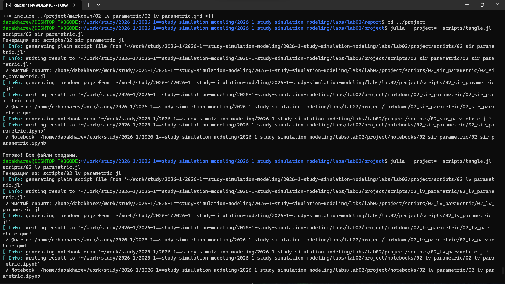
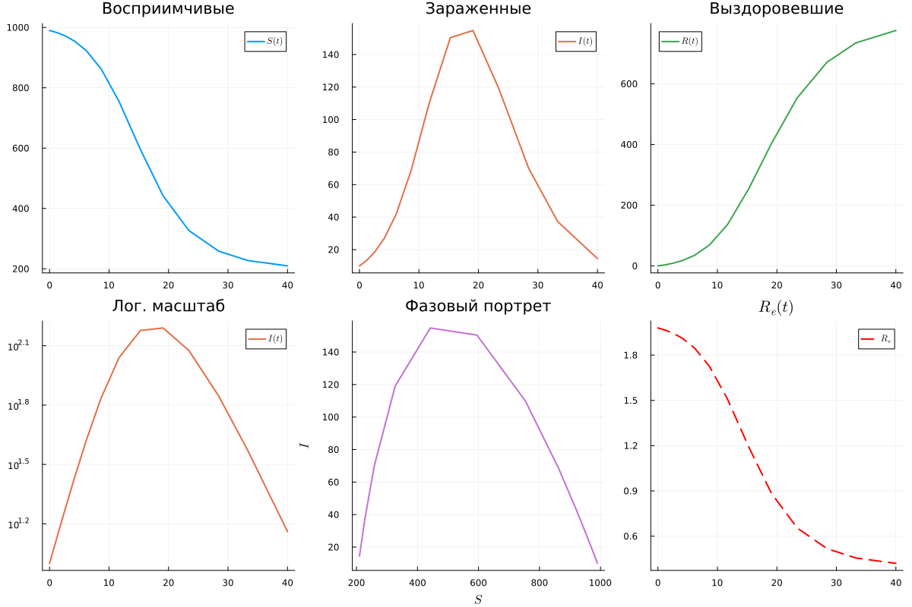
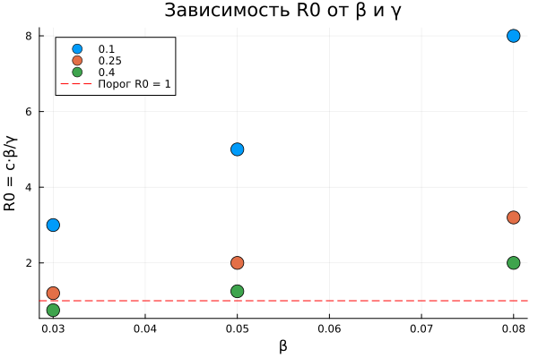
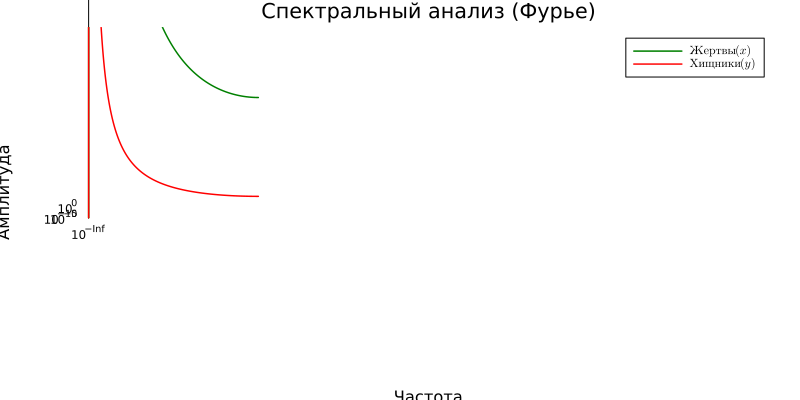
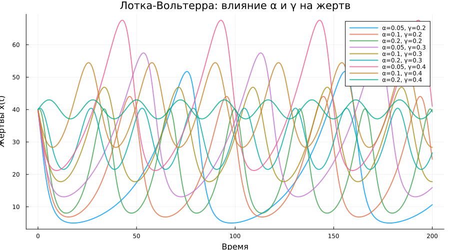
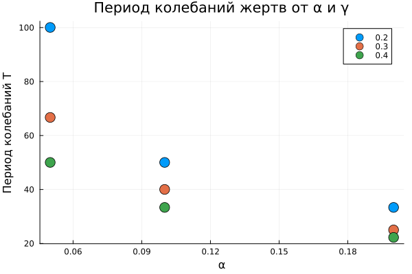
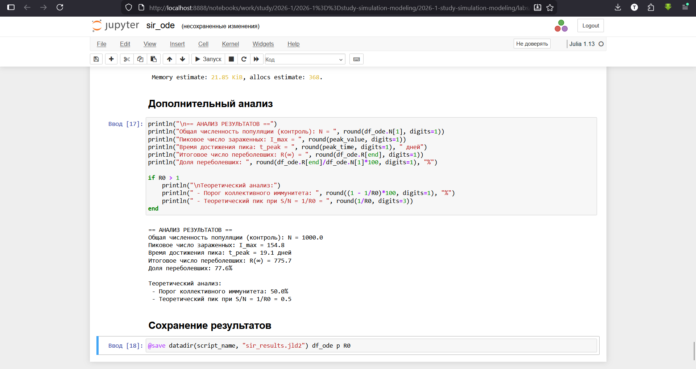
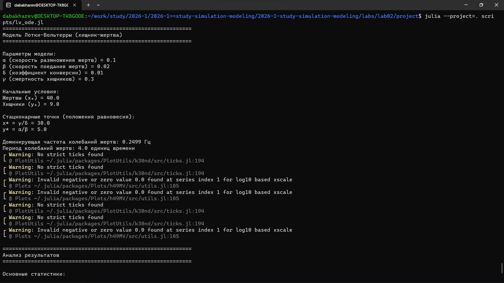

---
## Author
author:
  - name: Бахарев Дмитрий Александрович
    group: НКНбд-01-23
    email: traap.luuvv@mail.ru
    affiliation:
      - name: Российский университет дружбы народов
        country: Российская Федерация
        postal-code: 117198
        city: Москва
        address: ул. Миклухо-Маклая, д. 6
## Title
title: Лабораторная работа №2
subtitle: Модели SIR и Лотки-Вольтерра
license: CC BY
---

# Введение

## Актуальность

- Модели SIR и Лотки-Вольтерра — базовые модели имитационного
  моделирования.
- SIR применяется в эпидемиологии, LV — в экологии и экономике.
- Численное решение ОДУ позволяет прогнозировать динамику систем.

## Цель и задачи

**Цель:** изучить модели SIR и Лотки-Вольтерра и провести
параметрические исследования.

**Задачи:**

1. Реализовать модель SIR в Julia.
2. Реализовать модель Лотки-Вольтерра.
3. Провести параметрические исследования.
4. Проанализировать графики.

# Теоретическая часть

## Модель SIR

Три группы: $S(t)$ — восприимчивые, $I(t)$ — инфицированные,
$R(t)$ — выздоровевшие.

$$
\begin{cases}
\dfrac{dS}{dt} = -\beta c \dfrac{S I}{N}, \\[6pt]
\dfrac{dI}{dt} = \beta c \dfrac{S I}{N} - \gamma I, \\[6pt]
\dfrac{dR}{dt} = \gamma I.
\end{cases}
$$

Базовое репродуктивное число: $R_0 = c \beta / \gamma$.

## Модель Лотки-Вольтерра

$$
\begin{cases}
\dfrac{dx}{dt} = \alpha x - \beta x y, \\[6pt]
\dfrac{dy}{dt} = -\gamma y + \delta x y.
\end{cases}
$$

Стационарное состояние: $x^* = \gamma/\delta$, $y^* = \alpha/\beta$.

# Реализация

## Создание проекта DrWatson

{width=60%}

## Запуск скрипта SIR

- **R₀ = 2.0**, пик заражённых $I_{max} = 154.8$ на 19-й день.
- Переболело **77.6%** популяции.

{width=70%}

## Генерация форматов

{width=60%}

{width=60%}

## Код скрипта SIR

{width=70%}

# Результаты SIR

## Динамика групп

{width=70%}

## Панель графиков

{width=70%}

## Фазовый портрет SIR

{width=70%}

## Параметрическое исследование SIR

{width=70%}

{width=70%}

# Результаты Лотки-Вольтерра

## Спектр и фазовый портрет

{width=70%}

{width=70%}

## Параметрическое исследование LV

{width=70%}

{width=70%}

{width=70%}

# Jupyter-ноутбуки

## SIR

{width=70%}

## Лотки-Вольтерра

{width=70%}

# Заключение

## Итоги

- Реализованы модели SIR и Лотки-Вольтерра.
- Проведены параметрические исследования.
- Проанализированы фазовые портреты и динамика.
- Отчёт собран в PDF и DOCX.

