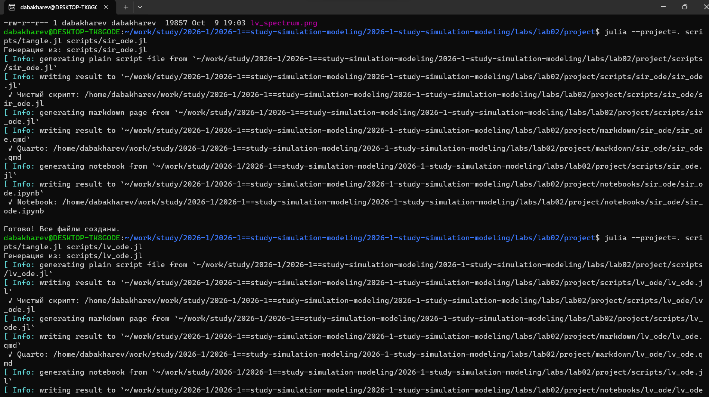
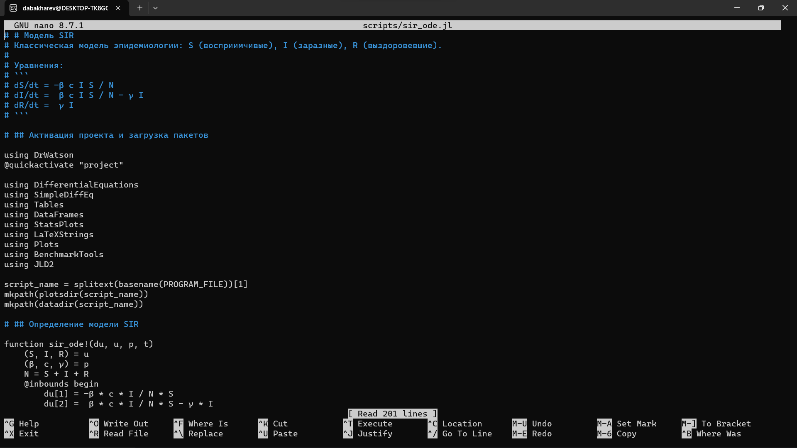
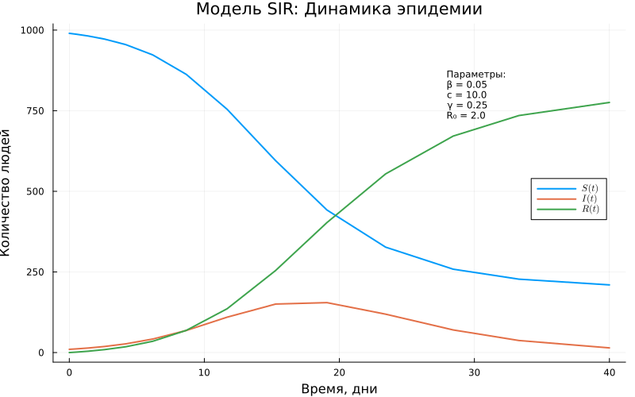
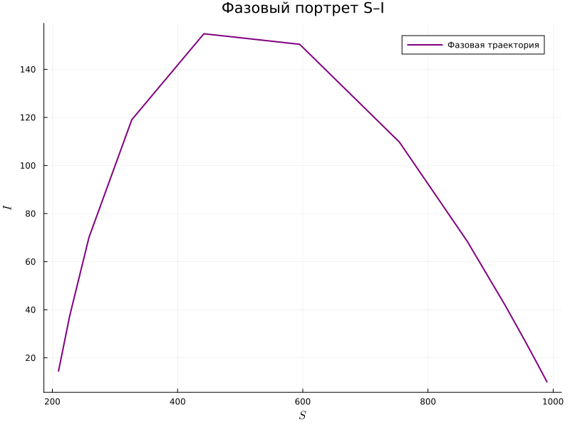
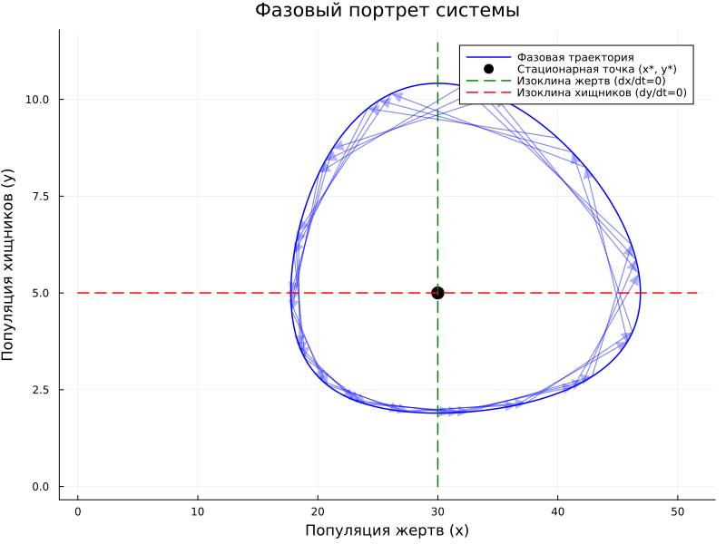
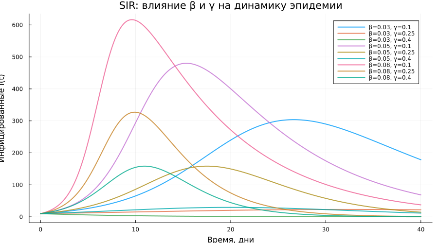
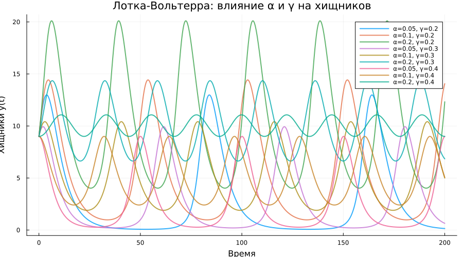

---
## Author
author:
  - name: Бахарев Дмитрий Александрович
    group: НКНбд-01-23
    email: traap.luuvv@mail.ru
    affiliation:
      - name: Российский университет дружбы народов
        country: Российская Федерация
        postal-code: 117198
        city: Москва
        address: ул. Миклухо-Маклая, д. 6
## Title
title: "Отчёт по лабораторной работе №2"
subtitle: "Имитационное моделирование"
license: "CC BY"
---

# Цель работы

Изучить базовые модели имитационного моделирования (SIR и Лотки-Вольтерра),
освоить их численную реализацию в Julia и провести параметрические
исследования.

# Задание

1. Реализовать модель эпидемии **SIR** в Julia.
2. Реализовать модель **«хищник-жертва»** Лотки-Вольтерра.
3. Провести параметрические исследования для обеих моделей.
4. Построить графики и проанализировать результаты.
5. Сгенерировать отчёт в форматах PDF и DOCX.

# Теоретическое введение

## Модель SIR

Модель SIR описывает распространение инфекции в популяции. Популяция
делится на три группы:

- $S(t)$ — восприимчивые к болезни, но пока здоровые;
- $I(t)$ — инфицированные, распространяющие инфекцию;
- $R(t)$ — выздоровевшие с иммунитетом.

Система уравнений:

$$
\begin{cases}
\dfrac{dS}{dt} = -\beta c \dfrac{S I}{N}, \\[6pt]
\dfrac{dI}{dt} = \beta c \dfrac{S I}{N} - \gamma I, \\[6pt]
\dfrac{dR}{dt} = \gamma I.
\end{cases}
$$

Здесь $\beta$ — вероятность заражения при контакте, $c$ — среднее число
контактов, $\gamma$ — скорость выздоровления. Базовое репродуктивное
число: $R_0 = c \beta / \gamma$.

## Модель Лотки-Вольтерра

Модель «хищник-жертва» описывает взаимодействие двух популяций:

$$
\begin{cases}
\dfrac{dx}{dt} = \alpha x - \beta x y, \\[6pt]
\dfrac{dy}{dt} = -\gamma y + \delta x y.
\end{cases}
$$

Здесь $x$ — численность жертв, $y$ — численность хищников.
Стационарное состояние: $x^* = \gamma/\delta$, $y^* = \alpha/\beta$.

# Выполнение лабораторной работы

## Создание проекта DrWatson

Проект DrWatson создан в каталоге `labs/lab02/project` командой
`initialize_project` (рис. @fig-1).

{#fig-1 width=70%}

## Запуск базового скрипта SIR

Скрипт `sir_ode.jl` реализует модель SIR. Параметры модели:

| Параметр | Значение |
|---|---|
| β (вероятность заражения) | 0.05 |
| c (среднее число контактов) | 10.0 |
| γ (скорость выздоровления) | 0.25 |
| **R₀ = c·β/γ** | **2.0** |
| Средняя продолжительность болезни | 4 дня |

Начальные условия: $S_0 = 990$, $I_0 = 10$, $R_0 = 0$.

Результаты численного решения приведены на рис. @fig-2.

{#fig-2 width=70%}

- Общая численность: $N = 1000$;
- Пиковое число заражённых: $I_{max} = 154.8$;
- Время достижения пика: $t_{peak} = 19.1$ дней;
- Итоговое число переболевших: $R(\infty) = 775.7$ (77.6%);
- Порог коллективного иммунитета: 50%.

## Генерация производных форматов

Через `tangle.jl` для обоих базовых скриптов сгенерированы три формата:
чистый скрипт, документация Quarto и Jupyter Notebook (рис. @fig-3).

{#fig-3 width=70%}

Для параметрических скриптов также сгенерированы три формата (рис. @fig-4).

{#fig-4 width=70%}

## Код скрипта sir_ode.jl

Код базового скрипта модели SIR приведён на рис. @fig-8.

{#fig-8 width=70%}

## Результаты SIR: основная динамика

Динамика трёх групп S(t), I(t), R(t) приведена на рис. @fig-5.

{#fig-5 width=70%}

Панель с несколькими графиками SIR показана на рис. @fig-6.

{#fig-6 width=70%}

Из графиков видно:

- Число восприимчивых $S(t)$ монотонно убывает — люди переболевают;
- Число инфицированных $I(t)$ имеет **характерный пик** на 19-й день;
- Число переболевших $R(t)$ растёт и выходит на плато $\approx 776$.

## Фазовый портрет SIR

Фазовый портрет модели SIR показан на рис. @fig-14.

{#fig-14 width=70%}

## Результаты LV: спектр и фазовый портрет

Спектр модели Лотки-Вольтерра приведён на рис. @fig-7.

{#fig-7 width=70%}

Фазовый портрет модели LV показан на рис. @fig-15.

{#fig-15 width=70%}

Из графиков видно:

- Динамика жертв и хищников имеет **колебательный характер**;
- Колебания происходят **в противофазе**;
- Фазовый портрет — **замкнутая кривая** (консервативная система).

## Параметрическое исследование SIR

Сравнение траекторий при разных $\beta$ приведено на рис. @fig-16.

{#fig-16 width=70%}

Зависимость $R_0$ от параметров показана на рис. @fig-17.

{#fig-17 width=70%}

## Параметрическое исследование LV

Параметрическое исследование динамики жертв приведено на рис. @fig-18.

{#fig-18 width=70%}

Параметрическое исследование динамики хищников показано на рис. @fig-19.

{#fig-19 width=70%}

Зависимость периода колебаний от параметров приведена на рис. @fig-20.

{#fig-20 width=70%}

## Jupyter-ноутбуки

Jupyter-ноутбук `sir_ode.ipynb` выполнен (рис. @fig-9).

{#fig-9 width=70%}

Jupyter-ноутбук `lv_ode.ipynb` выполнен (рис. @fig-10).

{#fig-10 width=70%}

## Листинги из Julia









# Заключение

В ходе лабораторной работы №2:

- Реализованы две базовые модели имитационного моделирования:
  SIR и Лотки-Вольтерра;
- Освоены численные методы решения ОДУ в Julia с использованием
  DrWatson и DifferentialEquations;
- Проведены параметрические исследования обеих моделей;
- Проанализированы графики динамики и фазовые портреты;
- Отчёт собран в PDF и DOCX, презентация — в PDF/HTML/Markdown.

# Список литературы {.unnumbered}

::: {#refs}
:::
