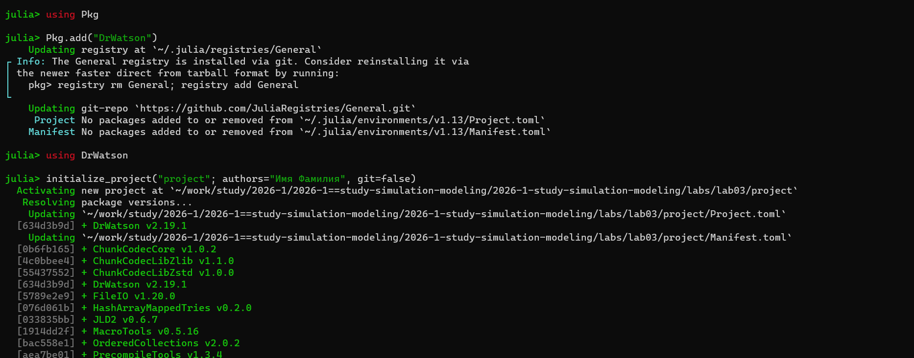
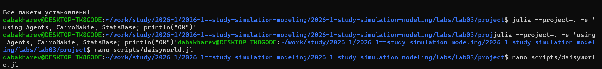
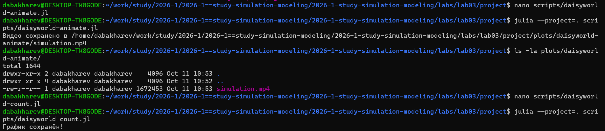
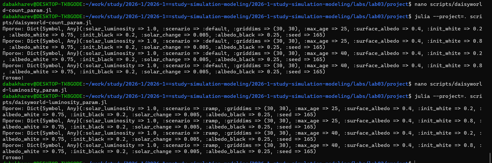
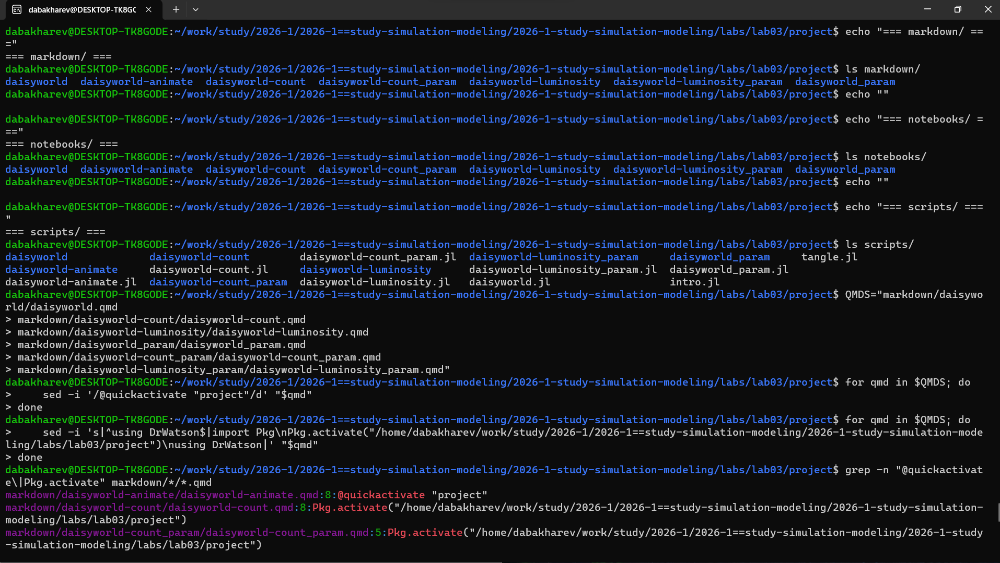
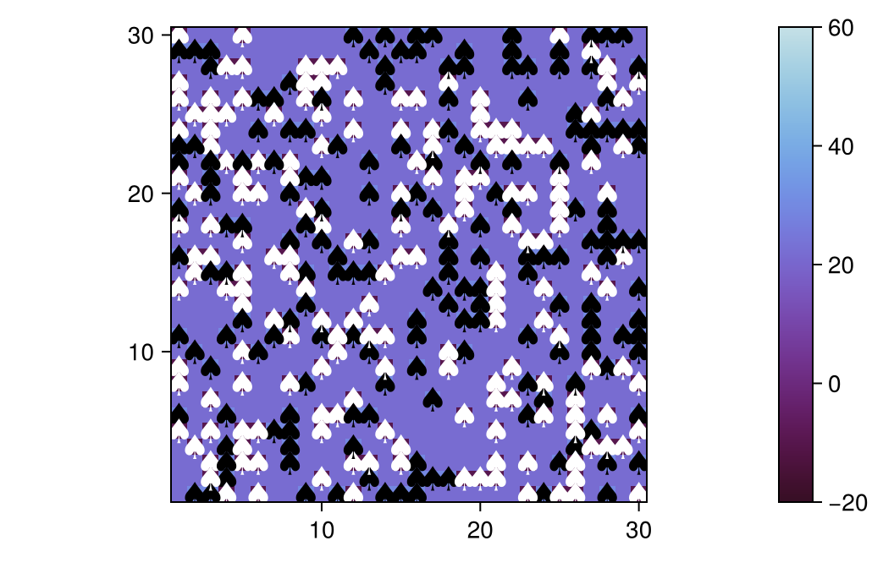
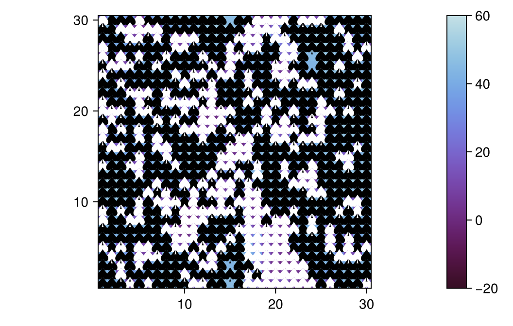
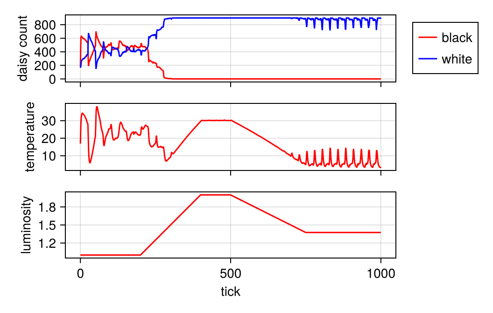
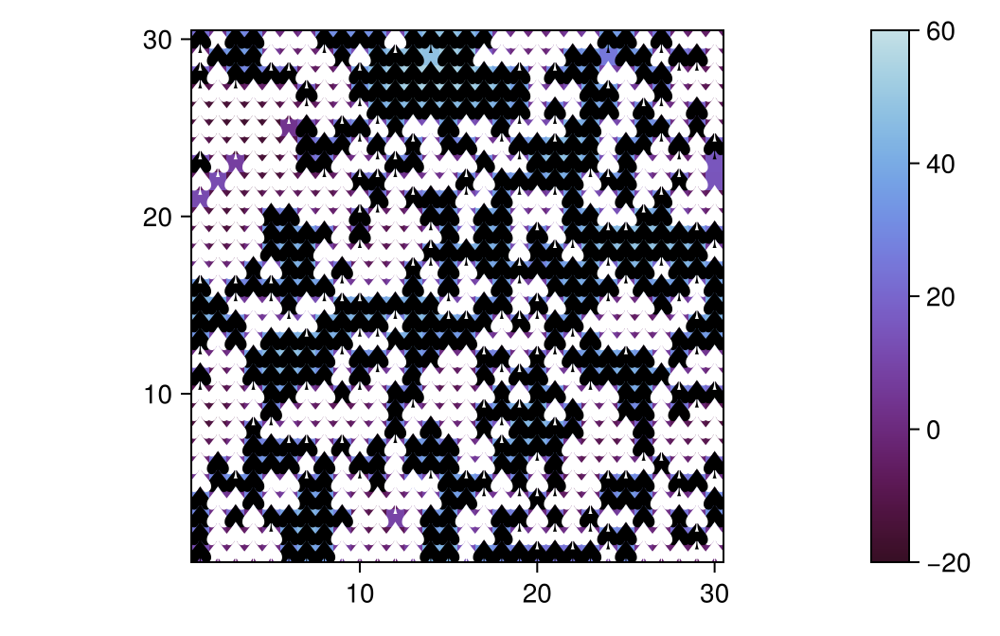
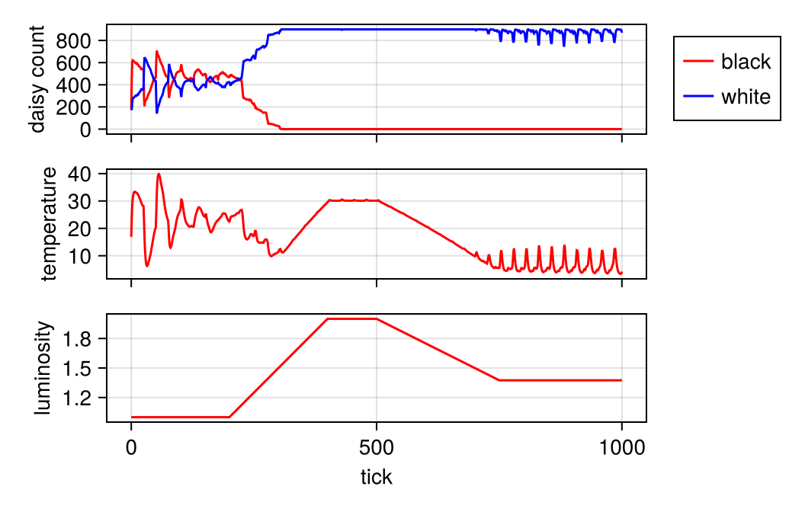

---
## Author
author:
  - name: Бахарев Дмитрий Александрович
    group: НКНбд-01-23
    email: traap.luuvv@mail.ru
    affiliation:
      - name: Российский университет дружбы народов
        country: Российская Федерация
        postal-code: 117198
        city: Москва
        address: ул. Миклухо-Маклая, д. 6
## Title
title: Лабораторная работа №3
subtitle: "DaisyWorld: агентное моделирование"
license: CC BY
---

# Введение

## Актуальность

- DaisyWorld — классическая агентная модель, иллюстрирующая гипотезу Геи.
- Демонстрирует саморегуляцию температуры без внешнего управления.
- Применяется в экологии, климатологии, теории сложных систем.

## Цель и задачи

**Цель:** изучить агентное моделирование в Julia на примере DaisyWorld
и исследовать параметрические зависимости.

**Задачи:**

1. Реализовать модель DaisyWorld с использованием Agents.jl.
2. Построить графики динамики.
3. Создать анимацию.
4. Провести параметрические исследования.

# Теоретическая часть

## Модель DaisyWorld

DaisyWorld — планета с двумя типами маргариток:
- **белые** (альбедо 0.75) — отражают свет, охлаждают;
- **чёрные** (альбедо 0.25) — поглощают свет, нагревают.

**Механизм:** маргаритки регулируют температуру планеты через альбедо.
Это классический пример саморегуляции.

## Параметры модели

| Параметр | Значение |
|---|---|
| `griddims` | (30, 30) |
| `max_age` | 25 / 40 |
| `init_white` | 0.2 / 0.8 |
| `albedo_white` | 0.75 |
| `albedo_black` | 0.25 |
| `solar_luminosity` | 1.0 |
| `solar_change` | 0.005 |

# Реализация

## Установка пакетов

{width=70%}

## Базовая модель

{width=60%}

## Анимация

{width=60%}

## Подсчёт маргариток

{width=60%}

## Светимость

{width=60%}

## Параметрические исследования

{width=60%}

{width=60%}

{width=60%}

## Генерация форматов

{width=60%}

# Результаты

## Эволюция DaisyWorld

{width=60%}

{width=60%}

{width=60%}

Из графиков видно:

- Планета постепенно заселяется маргаритками;
- Белые и чёрные конкурируют за территорию;
- Система выходит на стабильное состояние.

## Численность маргариток

{width=70%}

## Зависимость от светимости

{width=70%}

## Параметрические зависимости

{width=70%}

{width=70%}

{width=70%}

{width=70%}

{width=70%}

{width=70%}

# Заключение

## Итоги

- Изучено агентное моделирование в Julia с Agents.jl.
- Реализована модель DaisyWorld.
- Построены графики динамики и численности.
- Создана анимация эволюции.
- Проведены параметрические исследования.
- Отчёт собран в PDF и DOCX.

