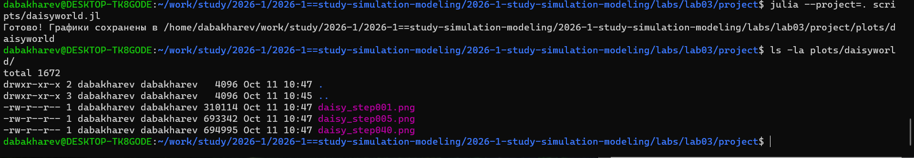
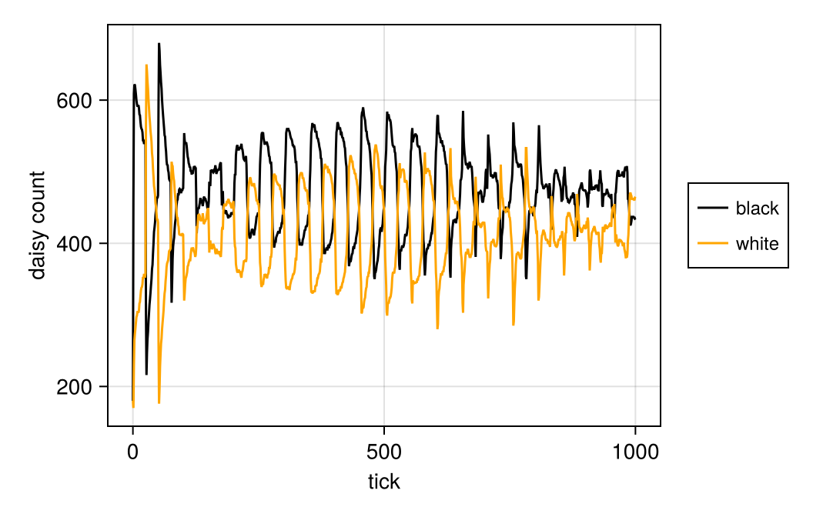
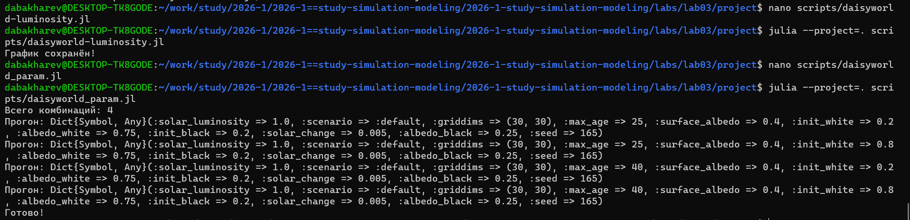
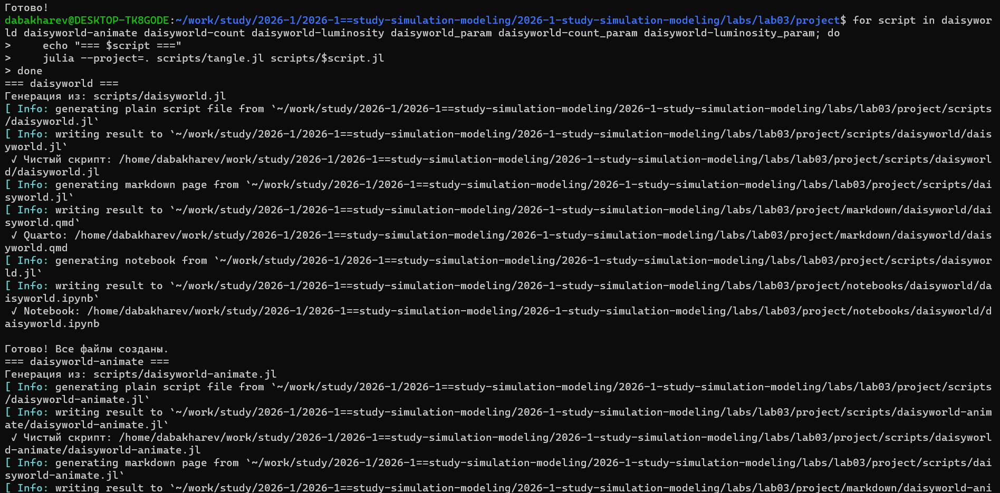
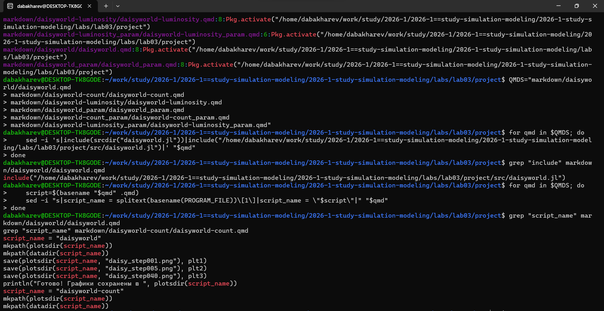
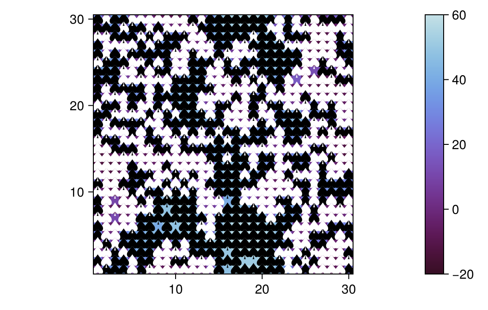
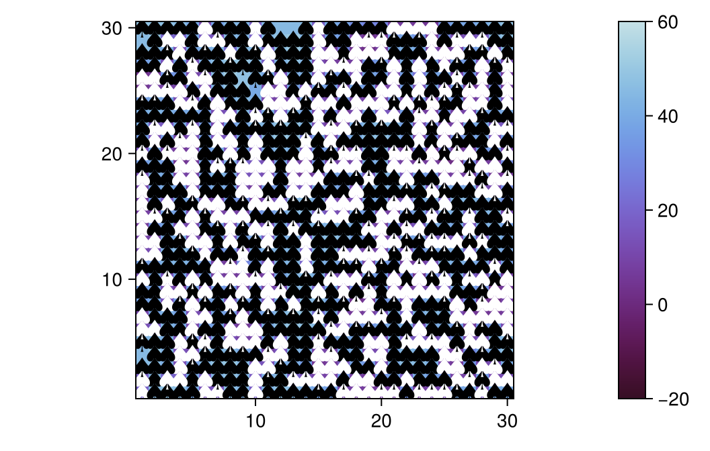
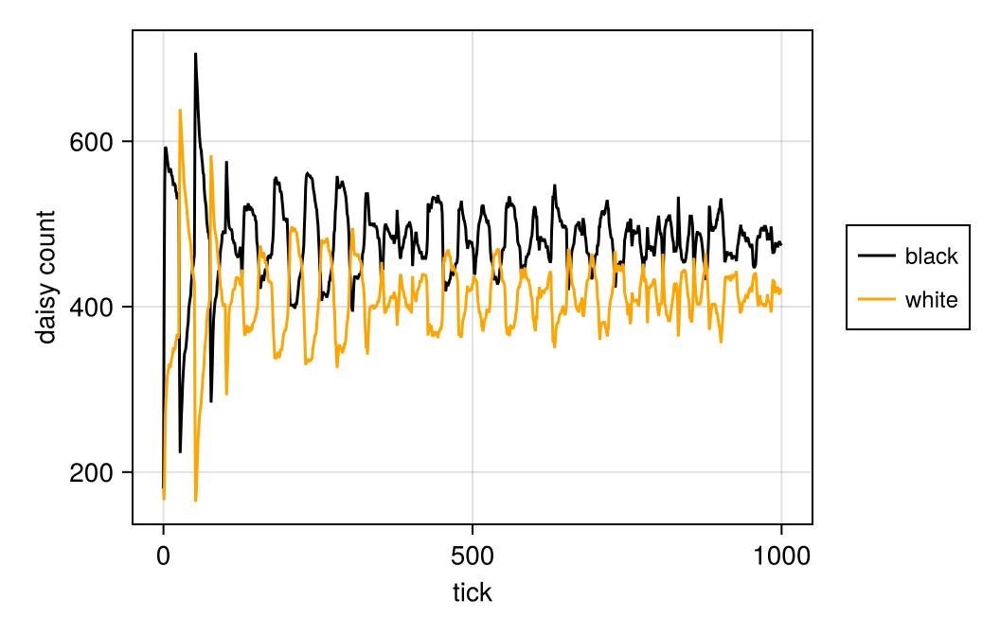
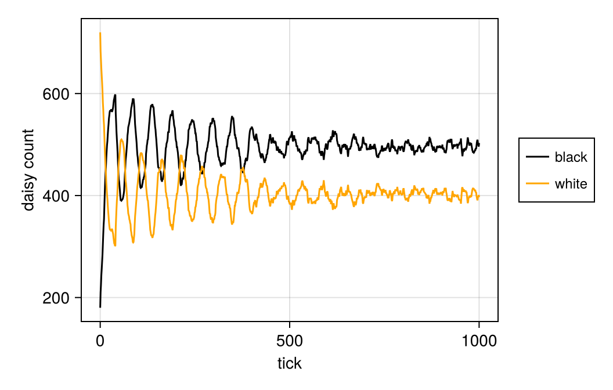
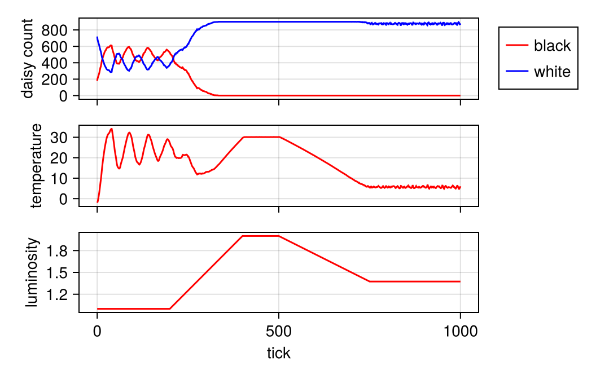

---
## Author
author:
  - name: Бахарев Дмитрий Александрович
    group: НКНбд-01-23
    email: traap.luuvv@mail.ru
    affiliation:
      - name: Российский университет дружбы народов
        country: Российская Федерация
        postal-code: 117198
        city: Москва
        address: ул. Миклухо-Маклая, д. 6
## Title
title: "Отчёт по лабораторной работе №3"
subtitle: "Имитационное моделирование. DaisyWorld"
license: "CC BY"
---

# Цель работы

Изучить агентное моделирование в Julia с использованием пакета Agents.jl
на примере модели DaisyWorld (мир маргариток). Исследовать динамику
системы и параметрические зависимости.

# Задание

1. Реализовать базовую модель DaisyWorld в Julia с использованием
   Agents.jl.
2. Построить графики динамики (температура, площадь маргариток).
3. Создать анимацию эволюции системы.
4. Провести параметрические исследования по параметрам `max_age`
   и `init_white`.
5. Исследовать зависимость от солнечной светимости.

# Теоретическое введение

## Модель DaisyWorld

DaisyWorld — классическая агентная модель, предложенная Джеймсом
Лавлоком для иллюстрации гипотезы Геи. Модель демонстрирует, как
простые агенты (маргаритки) могут регулировать температуру планеты
без внешнего управления.

**Основные компоненты:**

- **Планета** — сетка $30 \times 30$, каждая клетка имеет свою
  температуру и альбедо.
- **Маргаритки** — двух типов: белые (альбедо 0.75) и чёрные (альбедо 0.25).
- **Солнце** — светимость $L(t)$ меняется во времени.

**Ключевой механизм:** белые маргаритки отражают больше света (охлаждают
планету), чёрные — поглощают (нагревают). Их взаимодействие стабилизирует
температуру.

## Параметры модели

| Параметр | Значение |
|---|---|
| `griddims` | (30, 30) |
| `max_age` | 25 или 40 |
| `init_white` | 0.2 или 0.8 |
| `init_black` | 0.2 |
| `albedo_white` | 0.75 |
| `albedo_black` | 0.25 |
| `solar_luminosity` | 1.0 |
| `solar_change` | 0.005 |
| `scenario` | `:default` или `:ramp` |

# Выполнение лабораторной работы

## Установка пакетов

Для агентного моделирования установлены пакеты **Agents.jl**,
**CairoMakie** (визуализация) и **StatsBase** (статистика) (рис. @fig-2).

{#fig-2 width=70%}

## Запуск базовой модели DaisyWorld

Скрипт `daisyworld.jl` реализует базовую модель. Результат запуска
и список графиков приведены на рис. @fig-3.

{#fig-3 width=70%}

Сгенерированы три графика для трёх моментов времени:

- `daisy_step001.png` — начальное состояние;
- `daisy_step005.png` — промежуточное;
- `daisy_step040.png` — установившееся.

## Анимация DaisyWorld

Скрипт `daisyworld-animate.jl` создаёт анимацию эволюции системы
(рис. @fig-4). Видео сохранено в формате `.mp4`.

{#fig-4 width=70%}

## Подсчёт маргариток

Скрипт `daisyworld-count.jl` подсчитывает численность белых и чёрных
маргариток во времени (рис. @fig-5).

{#fig-5 width=70%}

График `daisy_count.png` приведён на рис. @fig-14.

{#fig-14 width=70%}

## Светимость Солнца

Скрипт `daisyworld-luminosity.jl` исследует зависимость температуры
от светимости (рис. @fig-6).

{#fig-6 width=70%}

График `daisy_luminosity.png` приведён на рис. @fig-15.

{#fig-15 width=70%}

## Параметрическое исследование

Скрипт `daisyworld_param.jl` проводит сканирование по 4 комбинациям
параметров (рис. @fig-7).

{#fig-7 width=70%}

Скрипт `daisyworld-count_param.jl` (рис. @fig-8) и
`daisyworld-luminosity_param.jl` (рис. @fig-9) проводят аналогичные
исследования для численности и светимости.

{#fig-8 width=70%}

{#fig-9 width=70%}

## Генерация производных форматов

Через `tangle.jl` для всех 7 скриптов сгенерированы три формата:
чистый скрипт, документация Quarto и Jupyter Notebook (рис. @fig-10).

{#fig-10 width=70%}

## Результаты: базовая динамика

Три ключевых момента эволюции DaisyWorld приведены
на рис. @fig-11, @fig-12, @fig-13.

{#fig-11 width=60%}

{#fig-12 width=60%}

{#fig-13 width=60%}

Из графиков видно:

- В начале планета заселяется белыми и чёрными маргаритками;
- Постепенно белые маргаритки вытесняют чёрные (или наоборот,
  в зависимости от светимости);
- Система выходит на стабильное состояние с постоянной температурой.

## Результаты: параметрическое исследование

Параметрическое исследование по `max_age` и `init_white` приведено
на рис. @fig-16 – @fig-21.

{#fig-16 width=70%}

{#fig-17 width=70%}

{#fig-18 width=70%}

{#fig-19 width=70%}

{#fig-20 width=70%}

{#fig-21 width=70%}

## Листинги из Julia





# Заключение

В ходе лабораторной работы №3:

- Изучено агентное моделирование в Julia с использованием Agents.jl;
- Реализована модель DaisyWorld;
- Построены графики динамики температуры и численности маргариток;
- Создана анимация эволюции системы;
- Проведены параметрические исследования по `max_age` и `init_white`;
- Исследована зависимость от солнечной светимости;
- Отчёт собран в PDF и DOCX, презентация — в PDF/HTML/Markdown.

# Список литературы {.unnumbered}

::: {#refs}
:::
