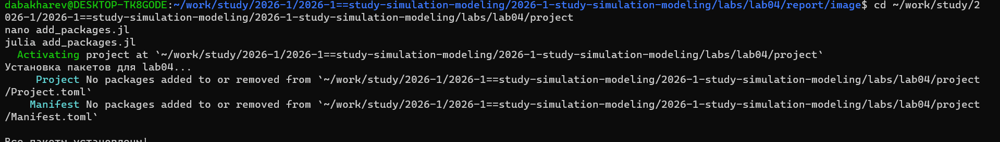
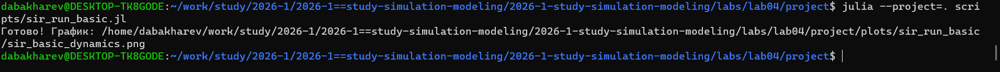
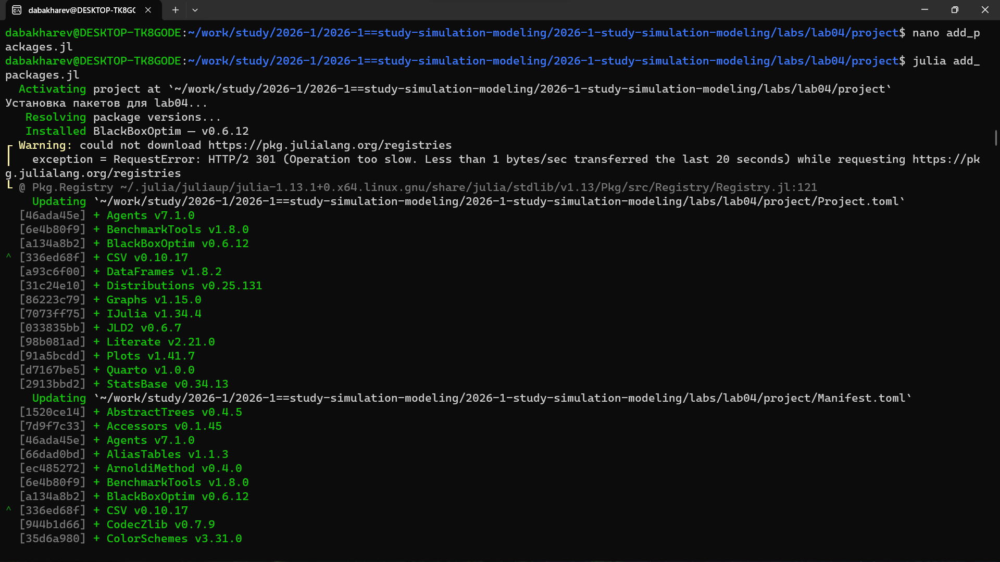
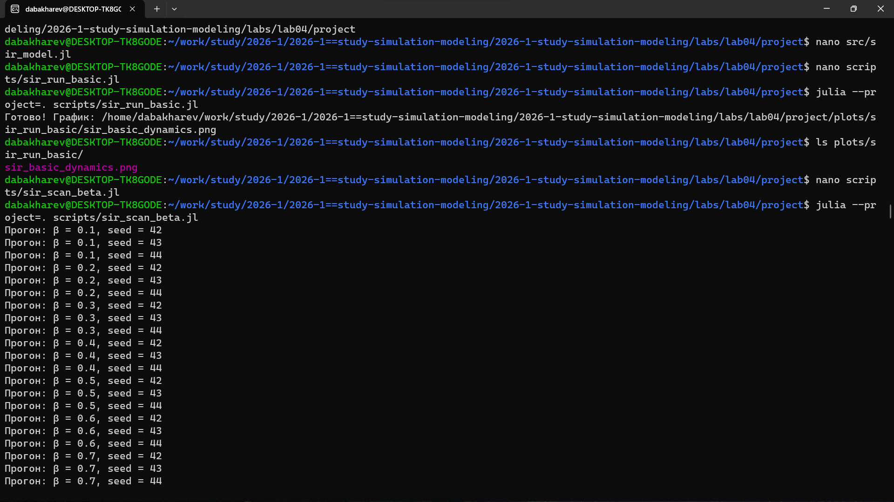
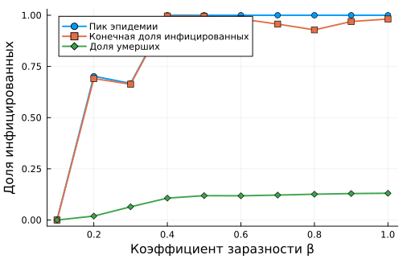

---
## Author
author:
  - name: Бахарев Дмитрий Александрович
    group: НКНбд-01-23
    email: traap.luuvv@mail.ru
    affiliation:
      - name: Российский университет дружбы народов
        country: Российская Федерация
        postal-code: 117198
        city: Москва
        address: ул. Миклухо-Маклая, д. 6
## Title
title: Лабораторная работа №4
subtitle: "SIR-модель с оптимизацией"
license: CC BY
---

# Введение

## Актуальность

- Агентное моделирование эпидемий — современный подход к SIR-моделям.
- Учёт индивидуальных агентов и миграции даёт более точные прогнозы.
- Оптимизация параметров позволяет минимизировать пик заражения.

## Цель и задачи

**Цель:** изучить агентное моделирование SIR и освоить оптимизацию
параметров.

**Задачи:**

1. Реализовать агентную SIR-модель с Agents.jl.
2. Провести базовое моделирование.
3. Провести параметрическое сканирование по β.
4. Выполнить многокритериальную оптимизацию (BlackBoxOptim).
5. Исследовать эффект миграции агентов.

# Теоретическая часть

## Модель SIR

$$
\begin{cases}
\dfrac{dS}{dt} = -\beta \dfrac{S I}{N}, \\[6pt]
\dfrac{dI}{dt} = \beta \dfrac{S I}{N} - \gamma I, \\[6pt]
\dfrac{dR}{dt} = \gamma I.
\end{cases}
$$

$S$ — восприимчивые, $I$ — инфицированные, $R$ — выздоровевшие.

## Агентное моделирование

В отличие от классической SIR, агентная модель описывает каждого
индивида как отдельного агента. Это позволяет учитывать:

- Пространственное распределение;
- Индивидуальные параметры;
- Эффекты миграции.

## Оптимизация

**BorgMOEA** — многокритериальная эволюционная оптимизация:

- Минимизация пика заражения;
- Минимизация доли умерших.

# Реализация

## Установка пакетов

{width=70%}

## Создание проекта DrWatson

{width=60%}

## Запуск базового скрипта

{width=60%}

{width=60%}

## Параметрическое сканирование

{width=60%}

## Оптимизация параметров

{width=60%}

**Оптимальные параметры:**

| Параметр | Значение |
|---|---|
| β_und | 0.160 |
| detection_time | 4 дня |
| death_rate | 0.059 |
| Пик заражения | 0.0008 |
| Доля умерших | 0.0 |

## Визуализация динамики

{width=60%}

## Генерация форматов

{width=60%}

# Результаты

## Базовая динамика SIR

{width=70%}

Видно:

- $S(t)$ монотонно убывает;
- $I(t)$ имеет характерный пик;
- $R(t)$ растёт и выходит на плато.

## Параметрическое сканирование по β

{width=70%}

При увеличении β:

- Пик заражения растёт;
- Время пика уменьшается;
- Доля переболевших увеличивается.

## Комплексный анализ

{width=70%}

## Эффект миграции

{width=70%}

Миграция ускоряет распространение инфекции — пик наступает раньше
и оказывается выше.

# Заключение

## Итоги

- Реализована агентная SIR-модель с Agents.jl.
- Проведено параметрическое сканирование по β.
- Выполнена многокритериальная оптимизация (BlackBoxOptim).
- Исследован эффект миграции.
- Отчёт собран в PDF и DOCX.

