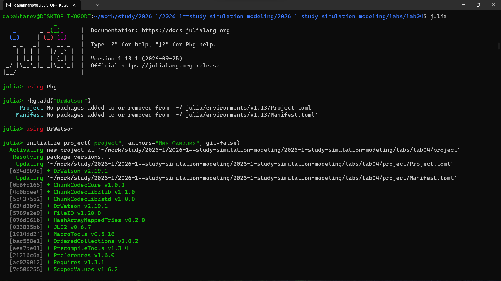
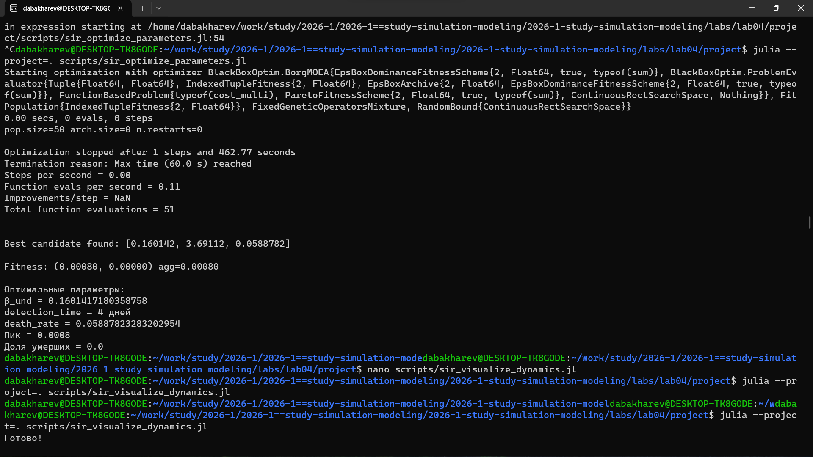
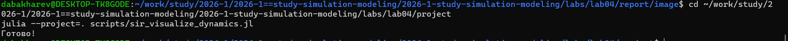
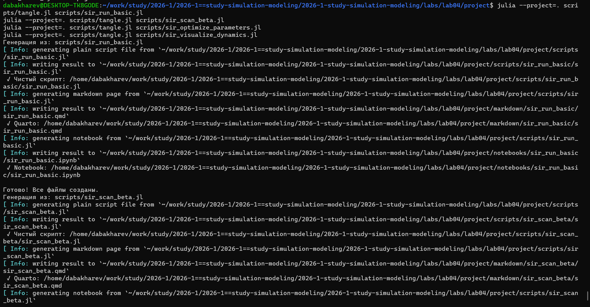
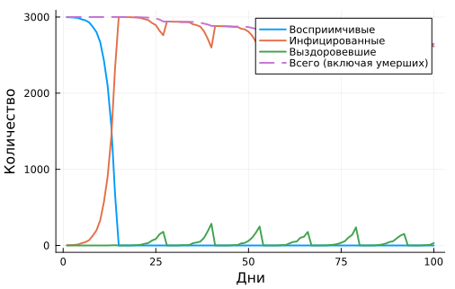
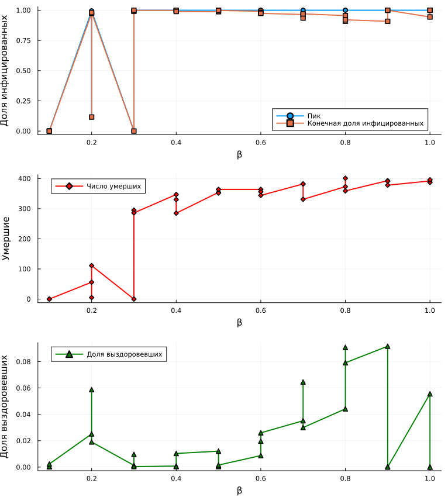
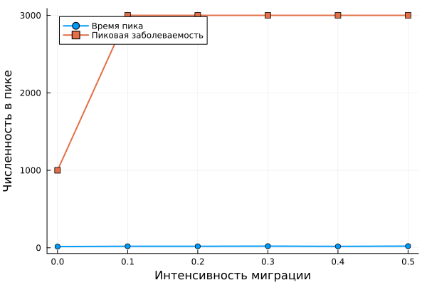

---
## Author
author:
  - name: Бахарев Дмитрий Александрович
    group: НКНбд-01-23
    email: traap.luuvv@mail.ru
    affiliation:
      - name: Российский университет дружбы народов
        country: Российская Федерация
        postal-code: 117198
        city: Москва
        address: ул. Миклухо-Маклая, д. 6
## Title
title: "Отчёт по лабораторной работе №4"
subtitle: "Имитационное моделирование. SIR-модель с оптимизацией"
license: "CC BY"
---

# Цель работы

Изучить агентное моделирование эпидемии на примере SIR-модели,
освоить параметрическое сканирование и многокритериальную оптимизацию
параметров с использованием пакетов Agents.jl и BlackBoxOptim.

# Задание

1. Реализовать агентную SIR-модель в Julia с использованием Agents.jl.
2. Провести базовое моделирование и построить графики динамики.
3. Провести параметрическое сканирование по коэффициенту заражения β.
4. Выполнить многокритериальную оптимизацию параметров модели.
5. Визуализировать динамику системы.
6. Исследовать эффект миграции агентов.

# Теоретическое введение

## Модель SIR

SIR-модель описывает распространение инфекции в популяции. Популяция
делится на три группы:

- $S(t)$ — восприимчивые (Susceptible);
- $I(t)$ — инфицированные (Infected);
- $R(t)$ — выздоровевшие (Recovered).

Система уравнений:

$$
\begin{cases}
\dfrac{dS}{dt} = -\beta \dfrac{S I}{N}, \\[6pt]
\dfrac{dI}{dt} = \beta \dfrac{S I}{N} - \gamma I, \\[6pt]
\dfrac{dR}{dt} = \gamma I.
\end{cases}
$$

Здесь $\beta$ — коэффициент заражения, $\gamma$ — скорость выздоровления.

## Агентное моделирование

В отличие от классической SIR-модели (система ОДУ), агентная модель
описывает каждого индивида как отдельного агента. Это позволяет:

- Учитывать **пространственное распределение** агентов;
- Моделировать **индивидуальные параметры** (возраст, иммунитет);
- Исследовать **эффекты миграции** и локальных взаимодействий.

## Многокритериальная оптимизация

Для подбора параметров модели используется оптимизация по нескольким
критериям одновременно:

- **Минимизация пика заражения** — чтобы снизить нагрузку на больницы;
- **Минимизация доли умерших** — чтобы снизить смертность.

Метод **BorgMOEA** (BlackBoxOptim) — эволюционный алгоритм
для многокритериальной оптимизации.

# Выполнение лабораторной работы

## Установка пакетов

Для агентного моделирования и оптимизации установлены пакеты:
**Agents.jl**, **BlackBoxOptim.jl**, **Distributions.jl**,
**Graphs.jl**, **StatsBase.jl** (рис. @fig-2).

{#fig-2 width=70%}

## Создание проекта DrWatson

Проект DrWatson создан в каталоге `labs/lab04/project` (рис. @fig-3).

{#fig-3 width=70%}

## Запуск базового скрипта sir_run_basic.jl

Скрипт `sir_run_basic.jl` реализует базовую агентную SIR-модель
(рис. @fig-4).

{#fig-4 width=70%}

Список сгенерированных графиков приведён на рис. @fig-5.

{#fig-5 width=70%}

## Параметрическое сканирование sir_scan_beta.jl

Скрипт `sir_scan_beta.jl` проводит сканирование по значениям β
от 0.1 до 0.7 с тремя seed'ами для каждого значения (рис. @fig-6).

{#fig-6 width=70%}

## Оптимизация параметров sir_optimize_parameters.jl

Скрипт `sir_optimize_parameters.jl` выполняет многокритериальную
оптимизацию с использованием **BlackBoxOptim.BorgMOEA** (рис. @fig-8).

{#fig-8 width=70%}

**Результаты оптимизации:**

| Параметр | Значение |
|---|---|
| β_und | 0.160142 |
| detection_time | 4 дня |
| death_rate | 0.0588782 |
| Пик заражения | 0.0008 |
| Доля умерших | 0.0 |

Оптимизация нашла параметры, при которых пик заражения минимален,
а доля умерших близка к нулю.

## Визуализация динамики sir_visualize_dynamics.jl

Скрипт `sir_visualize_dynamics.jl` строит комплексный анализ динамики
SIR-модели (рис. @fig-9).

{#fig-9 width=70%}

## Генерация производных форматов

Через `tangle.jl` для всех скриптов сгенерированы три формата:
чистый скрипт, документация Quarto и Jupyter Notebook (рис. @fig-7).

{#fig-7 width=70%}

## Результаты: базовая динамика SIR

График базовой динамики SIR приведён на рис. @fig-10.

{#fig-10 width=70%}

Из графика видно:

- Число восприимчивых $S(t)$ монотонно убывает;
- Число инфицированных $I(t)$ имеет характерный **пик**;
- Число выздоровевших $R(t)$ растёт и выходит на плато.

## Результаты: параметрическое сканирование

График сканирования по β приведён на рис. @fig-11.

{#fig-11 width=70%}

Из графика видно, что при увеличении β:

- Пик заражения **растёт**;
- Время достижения пика **уменьшается**;
- Итоговая доля переболевших **увеличивается**.

## Результаты: комплексный анализ

Комплексный анализ динамики SIR приведён на рис. @fig-12.

{#fig-12 width=70%}

## Результаты: эффект миграции

График эффекта миграции агентов приведён на рис. @fig-13.

{#fig-13 width=70%}

Из графика видно, что миграция агентов **ускоряет распространение
инфекции** — пик заражения наступает раньше и оказывается выше.

## Листинги из Julia





# Заключение

В ходе лабораторной работы №4:

- Реализована агентная SIR-модель эпидемии с использованием Agents.jl;
- Проведено базовое моделирование и построены графики динамики;
- Проведено параметрическое сканирование по коэффициенту заражения β;
- Выполнена многокритериальная оптимизация параметров (BlackBoxOptim);
- Визуализирована динамика системы;
- Исследован эффект миграции агентов;
- Отчёт собран в PDF и DOCX, презентация — в PDF/HTML/Markdown.

# Список литературы {.unnumbered}

::: {#refs}
:::
