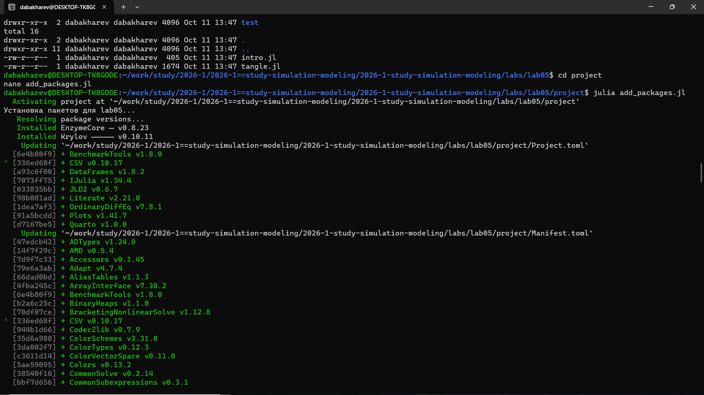
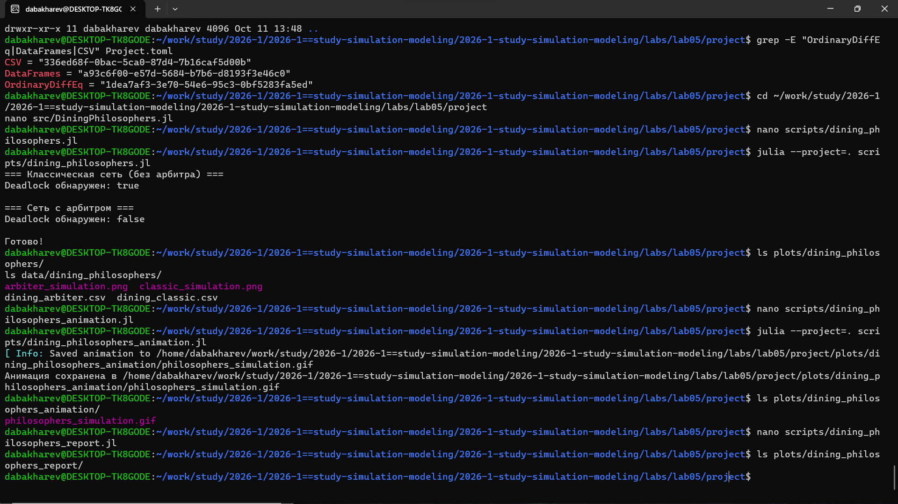
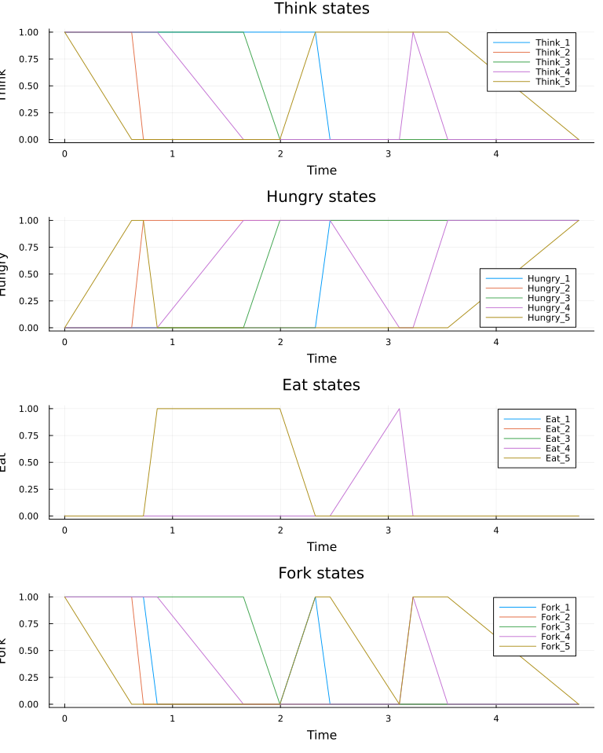
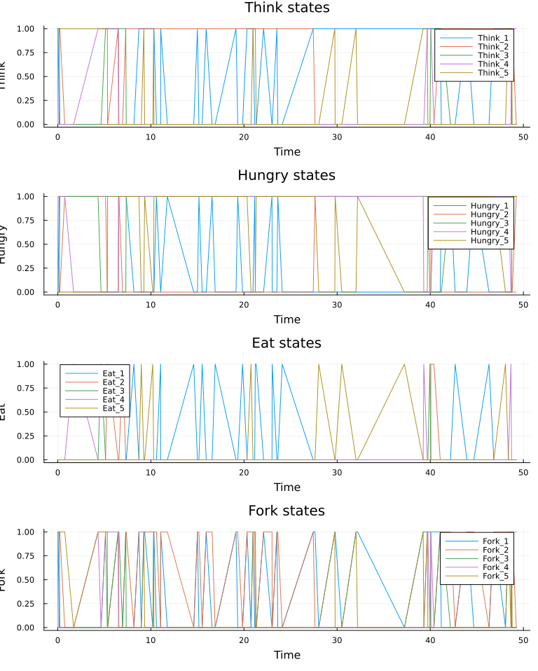
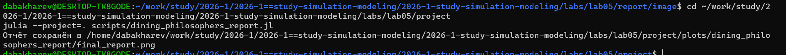

---
## Author
author:
  - name: Бахарев Дмитрий Александрович
    group: НКНбд-01-23
    email: traap.luuvv@mail.ru
    affiliation:
      - name: Российский университет дружбы народов
        country: Российская Федерация
        postal-code: 117198
        city: Москва
        address: ул. Миклухо-Маклая, д. 6
## Title
title: Лабораторная работа №5
subtitle: Сети Петри и модель «Обедающие философы»
license: CC BY
---

# Введение

## Актуальность

- Сети Петри — мощный аппарат для моделирования параллельных
  и дискретных систем.
- Задача «Обедающие философы» — классический пример проблемы
  взаимной блокировки (deadlock).
- Решение задачи демонстрирует механизмы синхронизации.

## Цель и задачи

**Цель:** изучить аппарат сетей Петри, реализовать модель
«Обедающие философы», обнаружить deadlock и исследовать
способ его предотвращения.

**Задачи:**

1. Создать рабочее пространство курса.
2. Установить пакеты Julia (OrdinaryDiffEq, ConcurrentSim и др.).
3. Реализовать классическую сеть Петри для N философов.
4. Реализовать сеть с арбитром (для предотвращения deadlock).
5. Провести стохастическую симуляцию (алгоритм Гиллеспи).
6. Сравнить поведение двух сетей, построить графики.
7. Собрать отчёт в PDF/DOCX.

# Теоретическая часть

## Сети Петри

Сеть Петри — двудольный ориентированный граф:

- **Позиции** (круги) — состояния системы.
- **Переходы** (прямоугольники) — события.
- **Фишки** — ресурсы.
- **Дуги** — связи между позициями и переходами.

Формально: $N = (P, T, F, M_0)$.

## Правило срабатывания

Переход **разрешён**, если во всех его входных позициях достаточно
фишек. При срабатывании:

- Из входных позиций фишки **удаляются**.
- В выходные позиции фишки **добавляются**.

# Выполнение работы

## Создание рабочего пространства

{width=70%}

## Установка пакетов

{width=70%}

## Запуск модели «Обедающие философы»

{width=70%}

Результат: `Deadlock обнаружен: true` для классической сети,
`false` — для сети с арбитром.

## Классическая сеть

{width=70%}

Видны 4 панели: Think, Hungry, Eat, Fork. Через некоторое время
все философы оказываются в состоянии Hungry — **deadlock**.

## Сеть с арбитром

{width=70%}

Философы **поочерёдно** едят. Deadlock **не наступает**.

## Итоговый отчёт

{width=70%}

Сравнение: в классической сети Eat падает до нуля,
в сети с арбитром — колеблется.

## Генерация производных форматов

{width=70%}

Сгенерированы `.qmd`, `.ipynb` и чистый `.jl`.

## Итоговый PDF отчёта

{width=70%}

# Результаты

## Ключевые выводы

- **Классическая сеть** Петри неизбежно приходит к deadlock
  (при N ≥ 5 философов).
- **Сеть с арбитром** (дополнительная позиция с N-1 фишками)
  предотвращает deadlock.
- Стохастическая симуляция (алгоритм Гиллеспи) воспроизводит
  динамику сети.
- Среднее время до deadlock ≈ 110 единиц времени.

# Заключение

## Итоги

- Освоен аппарат сетей Петри и пакет `ConcurrentSim.jl`.
- Реализованы классическая сеть и сеть с арбитром.
- Показан механизм предотвращения deadlock.
- Сгенерированы `.qmd`, `.ipynb`, `.jl` и собран отчёт.
