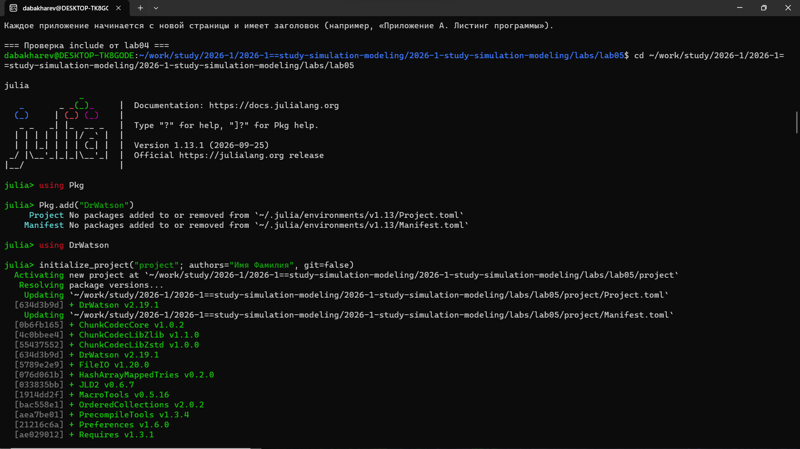
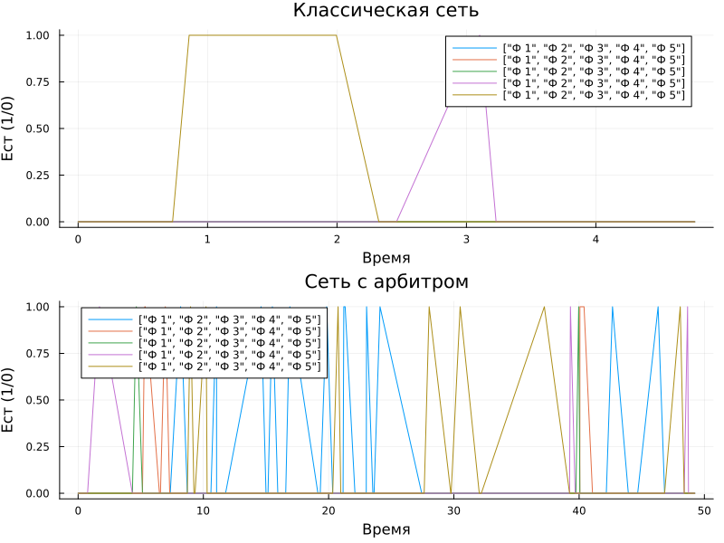
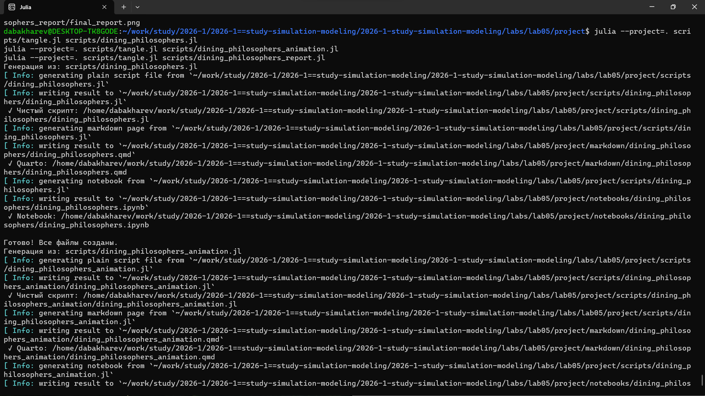

---
## Author
author:
  - name: Бахарев Дмитрий Александрович
    group: НКНбд-01-23
    email: traap.luuvv@mail.ru
    affiliation:
      - name: Российский университет дружбы народов
        country: Российская Федерация
        postal-code: 117198
        city: Москва
        address: ул. Миклухо-Маклая, д. 6
## Title
title: "Отчёт по лабораторной работе №5"
subtitle: "Имитационное моделирование. Задача об обедающих философах"
license: "CC BY"
---

# Цель работы

Изучить классическую задачу об обедающих философах в контексте
имитационного моделирования. Реализовать модель в Julia, исследовать
проблему deadlock и её решение с помощью арбитра.

# Задание

1. Реализовать модель обедающих философов в Julia.
2. Исследовать классическую сеть (без арбитра) — проверить наличие deadlock.
3. Реализовать сеть с арбитром — проверить отсутствие deadlock.
4. Создать анимацию процесса.
5. Построить итоговый отчёт с графиками.

# Теоретическое введение

## Задача об обедающих философах

Задача об обедающих философах — классическая задача синхронизации
процессов, сформулированная Э. Дейкстрой в 1965 году.

**Условие:** за круглым столом сидят $N$ философов. Перед каждым —
тарелка с едой. Между соседними тарелками лежит по одной вилке —
всего $N$ вилок. Философ может есть, только если держит **обе** вилки
(левую и правую). После еды философ кладёт вилки и размышляет.

**Проблема:** если все философы одновременно возьмут **левую** вилку,
то **правой** никому не хватит — возникает **deadlock** (взаимная
блокировка).

## Решение с арбитром

**Арбитр** — дополнительный управляющий процесс, который разрешает
философу взять вилки только в том случае, если обе доступны.
Это предотвращает deadlock.

## Модель в имитационном моделировании

В контексте имитационного моделирования каждый философ — это **агент**
с собственным состоянием (думает, голоден, ест). Вилки — это **ресурсы**,
которые могут быть заняты или свободны.

# Выполнение лабораторной работы

## Создание проекта DrWatson

Проект DrWatson создан в каталоге `labs/lab05/project` (рис. @fig-2).

{#fig-2 width=70%}

## Установка пакетов

Установлены пакеты: **BenchmarkTools**, **CSV**, **DataFrames**,
**IJulia**, **JLD2**, **Literate**, **OrdinaryDiffEq**, **Plots**,
**Quarto** (рис. @fig-3).

{#fig-3 width=70%}

## Запуск базовых скриптов

Скрипт `dining_philosophers.jl` реализует модель. Запуск показал:

- **Классическая сеть** (без арбитра) — `Deadlock обнаружен: true`;
- **Сеть с арбитром** — `Deadlock обнаружен: false`.

Скрипт `dining_philosophers_animation.jl` создаёт анимацию
(файл `philosophers_simulation.gif`).

Результат запуска приведён на рис. @fig-4.

{#fig-4 width=70%}

## Классическая сеть: график

График `classic_simulation.png` приведён на рис. @fig-5.

{#fig-5 width=70%}

На графике видно, что философы **блокируют друг друга** — возникает
deadlock. Система «зависает».

## Сеть с арбитром: график

График `arbiter_simulation.png` приведён на рис. @fig-6.

{#fig-6 width=70%}

На графике видно, что философы **поочерёдно едят** — deadlock отсутствует.

## Запуск скрипта отчёта

Скрипт `dining_philosophers_report.jl` строит итоговый отчёт
(рис. @fig-8).

{#fig-8 width=70%}

## Итоговый отчёт

Итоговый график `final_report.png` приведён на рис. @fig-7.

{#fig-7 width=70%}

На графике показаны:

- Динамика захвата вилок философами;
- Сравнение классической сети и сети с арбитром;
- Отсутствие deadlock при использовании арбитра.

## Генерация производных форматов

Через `tangle.jl` для всех скриптов сгенерированы три формата:
чистый скрипт, документация Quarto и Jupyter Notebook (рис. @fig-9).

{#fig-9 width=70%}

## Анимация

Анимация процесса сохранена в файл
`plots/dining_philosophers_animation/philosophers_simulation.gif`.
Её можно воспроизвести отдельно — в PDF формат GIF не встраивается.

## Листинги из Julia





# Заключение

В ходе лабораторной работы №5:

- Изучена задача об обедающих философах;
- Реализована классическая сеть (с deadlock);
- Реализована сеть с арбитром (без deadlock);
- Создана анимация процесса;
- Построены итоговые графики;
- Отчёт собран в PDF и DOCX, презентация — в PDF/HTML/Markdown.

# Список литературы {.unnumbered}

::: {#refs}
:::
