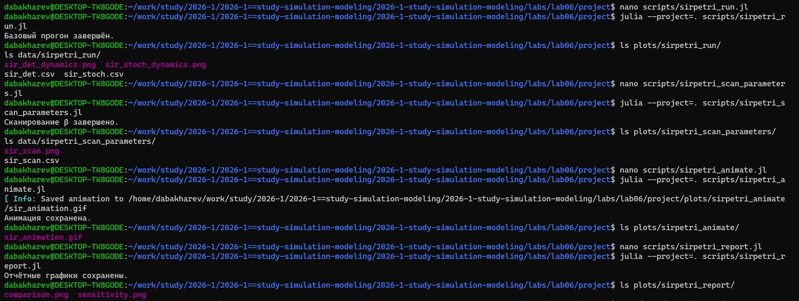
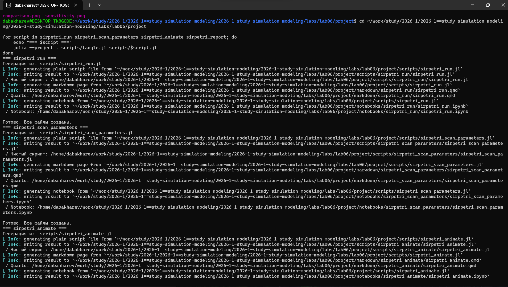
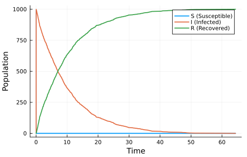
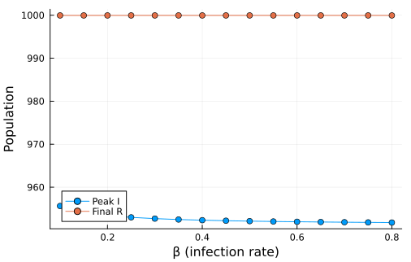
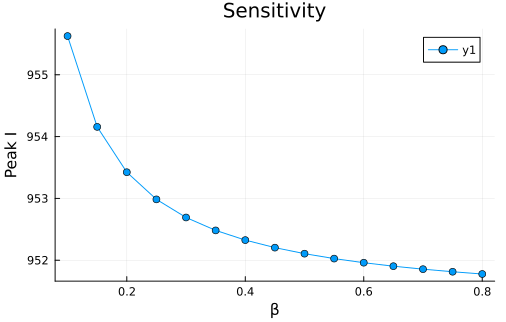

---
## Author
author:
  - name: Бахарев Дмитрий Александрович
    group: НКНбд-01-23
    email: traap.luuvv@mail.ru
    affiliation:
      - name: Российский университет дружбы народов
        country: Российская Федерация
        postal-code: 117198
        city: Москва
        address: ул. Миклухо-Маклая, д. 6
## Title
title: Лабораторная работа №6
subtitle: Модель SIR через сети Петри
license: CC BY
---

# Введение

## Актуальность

- Модель SIR — классическая модель эпидемиологии.
- Сети Петри позволяют моделировать дискретные события
  (заражение, выздоровление).
- Пакет **AlgebraicPetri.jl** реализует сети Петри в Julia.

## Цель и задачи

**Цель:** реализовать модель SIR через сети Петри, провести
детерминированную и стохастическую симуляции.

**Задачи:**

1. Создать DrWatson-проект.
2. Установить пакеты AlgebraicPetri, Catlab и др.
3. Построить сеть Петри: `infection` и `recovery`.
4. Провести ODE-симуляцию (Tsit5).
5. Провести стохастическую симуляцию (Gillespie).
6. Сканировать параметр β.
7. Собрать отчёт в PDF/DOCX.

# Теоретическая часть

## Модель SIR

$$
\begin{cases}
\dfrac{dS}{dt} = -\beta \dfrac{S I}{N}, \\[6pt]
\dfrac{dI}{dt} = \beta \dfrac{S I}{N} - \gamma I, \\[6pt]
\dfrac{dR}{dt} = \gamma I.
\end{cases}
$$

## Сеть Петри для SIR

- **Позиции:** $S, I, R$.
- **Переходы:**
  - `infection`: $S + I \to I + I$ (скорость $\beta$).
  - `recovery`: $I \to R$ (скорость $\gamma$).

# Выполнение работы

## Создание проекта

{width=70%}

## Установка пакетов

{width=70%}

## Flat-модуль SIRPetri

{width=70%}

## Запуск скриптов

{width=70%}

## Генерация производных форматов

{width=70%}

## Детерминированная симуляция

{width=70%}

## Стохастическая симуляция

{width=70%}

## Сканирование β

{width=70%}

## Анимация

{width=70%}

## Сравнение динамики

{width=70%}

## Чувствительность к β

{width=70%}

# Результаты

## Ключевые выводы

- **AlgebraicPetri.jl** позволяет строить сети Петри в Julia.
- **Детерминированная** (ODE) и **стохастическая** (Gillespie)
  симуляции дают близкие результаты при большом $N$.
- С ростом $\beta$ **пик эпидемии** растёт, затем насыщается.
- Пороговое значение $\beta$ соответствует $R_0 = 1$.

# Заключение

## Итоги

- Освоен пакет `AlgebraicPetri.jl`.
- Реализована модель SIR через сеть Петри.
- Проведены детерминированная и стохастическая симуляции.
- Сгенерированы `.jl`, `.qmd`, `.ipynb` и собран отчёт.
