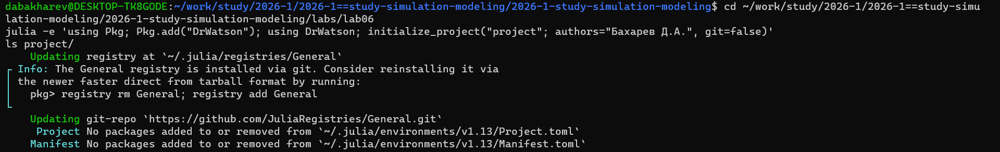
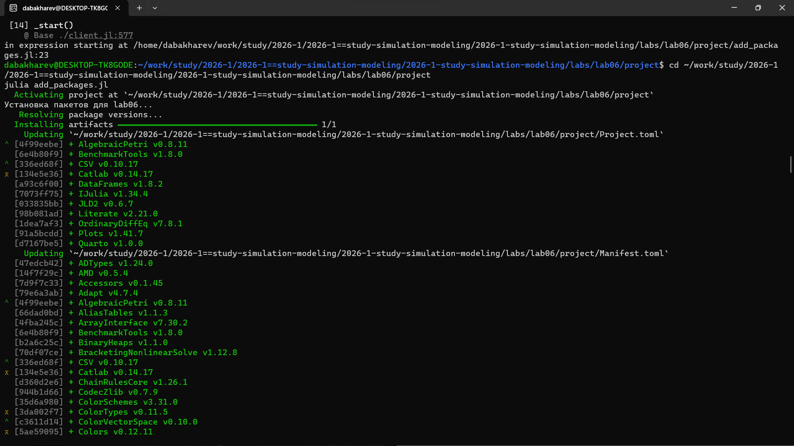
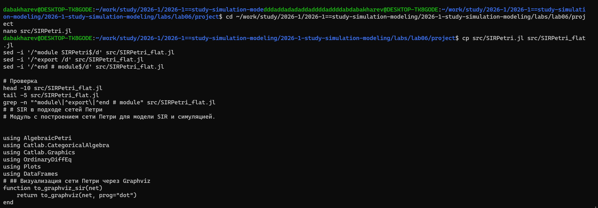
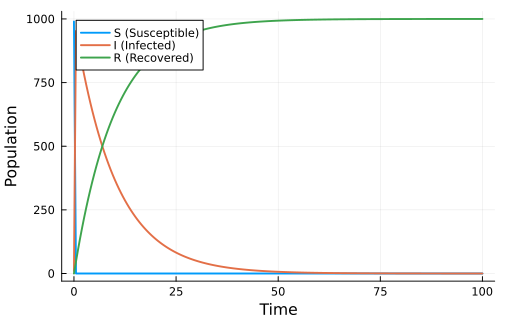
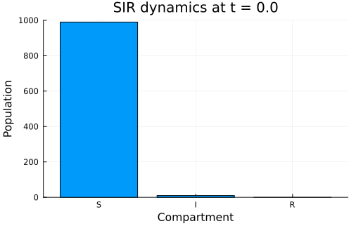
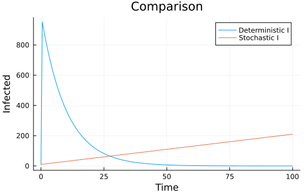

---
## Author
author:
  - name: Бахарев Дмитрий Александрович
    group: НКНбд-01-23
    email: traap.luuvv@mail.ru
    affiliation:
      - name: Российский университет дружбы народов
        country: Российская Федерация
        postal-code: 117198
        city: Москва
        address: ул. Миклухо-Маклая, д. 6
## Title
title: "Отчёт по лабораторной работе №6"
subtitle: "Имитационное моделирование"
license: "CC BY"
---

# Цель работы

Реализовать модель SIR с использованием сетей Петри, провести
детерминированную и стохастическую симуляции, исследовать
влияние параметра заражения β.

# Задание

— Создать рабочий каталог для кода.
— Установить необходимые пакеты.
— Выполнить предложенный код.
— Преобразовать код в литературный стиль.
— Сгенерировать из литературного кода:
  — чистый код;
  — jupyter notebook;
  — документацию в формате Quarto.
— Выполнить код из jupyter notebook.
— Интегрировать документацию в формате Quarto в отчёт.
— Добавить в код в литературном стиле вычисление для набора параметров.
— Сгенерировать из литературного кода с параметрами:
  — чистый код;
  — jupyter notebook;
  — документацию в формате Quarto.
— Выполнить код из jupyter notebook с параметрами.
— Интегрировать документацию с параметрами в формате Quarto в отчёт.

# Теоретическое введение

## Модель SIR

Модель SIR делит популяцию на три группы:

- $S$ (Susceptible) — восприимчивые;
- $I$ (Infectious) — инфицированные;
- $R$ (Recovered) — выздоровевшие.

Классическая модель описывается системой ОДУ:

$$
\begin{cases}
\dfrac{dS}{dt} = -\beta \dfrac{S I}{N}, \\[6pt]
\dfrac{dI}{dt} = \beta \dfrac{S I}{N} - \gamma I, \\[6pt]
\dfrac{dR}{dt} = \gamma I.
\end{cases}
$$

## Сети Петри

Сеть Петри формально задаётся четвёркой $N = (P, T, F, M_0)$:

- $P$ — позиции (состояния);
- $T$ — переходы (события);
- $F$ — дуги;
- $M_0$ — начальная маркировка.

В модели SIR:

- `infection`: $S + I \to I + I$ (скорость $\beta$);
- `recovery`: $I \to R$ (скорость $\gamma$).

# Выполнение лабораторной работы

## Создание рабочего пространства

Проект DrWatson создан в каталоге `labs/lab06/project` (рис. @fig-1).

{#fig-1 width=70%}

## Установка пакетов

Устанавливаю пакеты AlgebraicPetri, Catlab, OrdinaryDiffEq, Plots,
DataFrames, CSV, JLD2, Literate, IJulia, BenchmarkTools, Quarto
(рис. @fig-2).

{#fig-2 width=70%}

## Модуль SIRPetri и flat-версия

Создаю модуль `SIRPetri.jl` с функцией `build_sir_network`
для построения сети Петри, а также `SIRPetri_flat.jl` — плоскую
версию без `module` для корректной работы в Quarto (рис. @fig-3).

{#fig-3 width=70%}

## Запуск скриптов

Создаю 4 скрипта: `sirpetri_run.jl`, `sirpetri_scan_parameters.jl`,
`sirpetri_animate.jl`, `sirpetri_report.jl`. Запускаю их по очереди
(рис. @fig-4).

{#fig-4 width=70%}

Видно, что все 4 скрипта завершаются успешно. Созданы графики
`sir_det_dynamics.png`, `sir_stoch_dynamics.png`, `sir_scan.png`,
`sir_animation.gif`, `comparison.png`, `sensitivity.png`.

## Генерация производных форматов

Запускаю `tangle.jl` для всех 4 скриптов. Для каждого генерируются
чистый скрипт, Quarto-документ и Jupyter-ноутбук (рис. @fig-5).

{#fig-5 width=70%}

## Детерминированная симуляция

График детерминированной динамики SIR (ODE, метод Tsit5)
приведён на рис. @fig-6.

{#fig-6 width=70%}

Видно классический пик эпидемии: рост $I$, максимум, затем спад;
$R$ растёт и выходит на плато.

## Стохастическая симуляция

График стохастической симуляции (алгоритм Гиллеспи) приведён
на рис. @fig-7.

{#fig-7 width=70%}

Стохастическая траектория близка к детерминированной при большом
начальном числе восприимчивых, но имеет случайные флуктуации.

## Сканирование параметра β

Диапазон $\beta \in [0.1, 0.8]$ с шагом $0.05$. На каждом шаге
вычисляются пик $I$ и финальное $R$ (рис. @fig-8).

{#fig-8 width=70%}

## Анимация

GIF-анимация динамики SIR сохранена в `sir_animation.gif` (рис. @fig-9).

{#fig-9 width=70%}

## Сравнение и чувствительность

Итоговые графики: сравнение детерминированной и стохастической
динамики (рис. @fig-10) и зависимость пика $I$ от $\beta$ (рис. @fig-11).

{#fig-10 width=70%}

{#fig-11 width=70%}

## Листинги из Julia









# Заключение

В ходе лабораторной работы №6:

- Освоен пакет **AlgebraicPetri.jl** для работы с сетями Петри.
- Реализована модель SIR через сеть Петри с двумя переходами
  (`infection` и `recovery`).
- Проведены детерминированная (ODE) и стохастическая (Gillespie)
  симуляции.
- Исследовано влияние параметра $\beta$ на пик эпидемии.
- Сгенерированы производные форматы `.jl`, `.qmd`, `.ipynb`.
- Отчёт собран в PDF и DOCX.

# Список литературы {.unnumbered}

::: {#refs}
:::
