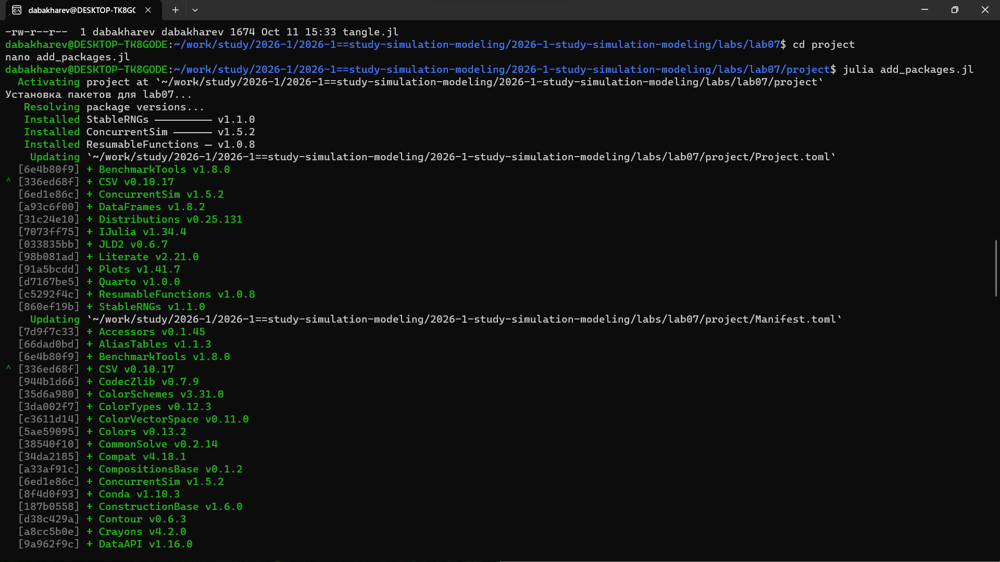

---
## Author
author:
  - name: Бахарев Дмитрий Александрович
    group: НКНбд-01-23
    email: traap.luuvv@mail.ru
    affiliation:
      - name: Российский университет дружбы народов
        country: Российская Федерация
        postal-code: 117198
        city: Москва
        address: ул. Миклухо-Маклая, д. 6
## Title
title: Лабораторная работа №7
subtitle: Дискретно-событийное моделирование (M/M/c и модель Росса)
license: CC BY
---

# Введение

## Актуальность

- Дискретно-событийное моделирование (DES) — ключевой инструмент
  анализа систем массового обслуживания.
- Модель M/M/c — классическая модель СМО с $c$ серверами.
- Модель Росса — система с резервом и ремонтом машин.
- Пакет `ConcurrentSim.jl` реализует DES в Julia.

## Цель и задачи

**Цель:** освоить дискретно-событийное моделирование в Julia
на примерах M/M/c и модели Росса.

**Задачи:**

1. Создать DrWatson-проект.
2. Установить пакеты `ConcurrentSim`, `ResumableFunctions`,
   `StableRNGs`, `Distributions`.
3. Реализовать модель M/M/c (многоканальная СМО).
4. Реализовать модель Росса (система с резервом).
5. Провести параметрические исследования.
6. Построить графики и собрать отчёт.

# Теоретическая часть

## Модель M/M/c

Система массового обслуживания с $c$ серверами:

- Входящий поток — пуассоновский с интенсивностью $\lambda$.
- Время обслуживания — экспоненциальное с интенсивностью $\mu$.
- Загрузка: $\rho = \lambda / (c \mu)$.
- **Условие стационарности:** $\rho < 1$.

## Модель Росса

Система с $N$ работающими машинами и $S$ запасными:

- Один ремонтник.
- Наработка до отказа $\sim \text{Exp}(\lambda)$.
- Время ремонта $\sim \text{Exp}(\mu)$.
- Система падает, когда резерв исчерпан.

# Выполнение работы

## Создание проекта

{width=70%}

## Файл add_packages.jl

{width=70%}

## Установка пакетов

{width=70%}

## Запуск модели M/M/c

{width=70%}

Видно: `Customer N arrived`, `entered service`, `exited service` —
события обрабатываются по времени.

## Запуск модели Росса

{width=70%}

| $S$ | Время до отказа |
|---|---|
| 1 | 20.77 |
| 2 | 1096.07 |
| 3 | 12802.25 |
| 5 | 840855.82 |

**Чем больше запасных — тем дольше система живёт.**

## Генерация производных форматов

{width=70%}

## Результаты M/M/c

{width=70%}

## Результаты модели Росса

{width=70%}

# Результаты

## Ключевые выводы

- **M/M/c** — многоканальная СМО с экспоненциальными распределениями.
- **Модель Росса** демонстрирует **экспоненциальный рост** времени
  до отказа с увеличением числа запасных машин $S$.
- Пакет `ConcurrentSim.jl` позволяет моделировать DES
  с помощью `@resumable` и `@yield`.
- Параметрические исследования показали физичные результаты.

# Заключение

## Итоги

- Освоен пакет `ConcurrentSim.jl` для DES.
- Реализованы модели M/M/c и Росса.
- Проведены параметрические исследования.
- Сгенерированы `.jl`, `.qmd`, `.ipynb` и собран отчёт.
