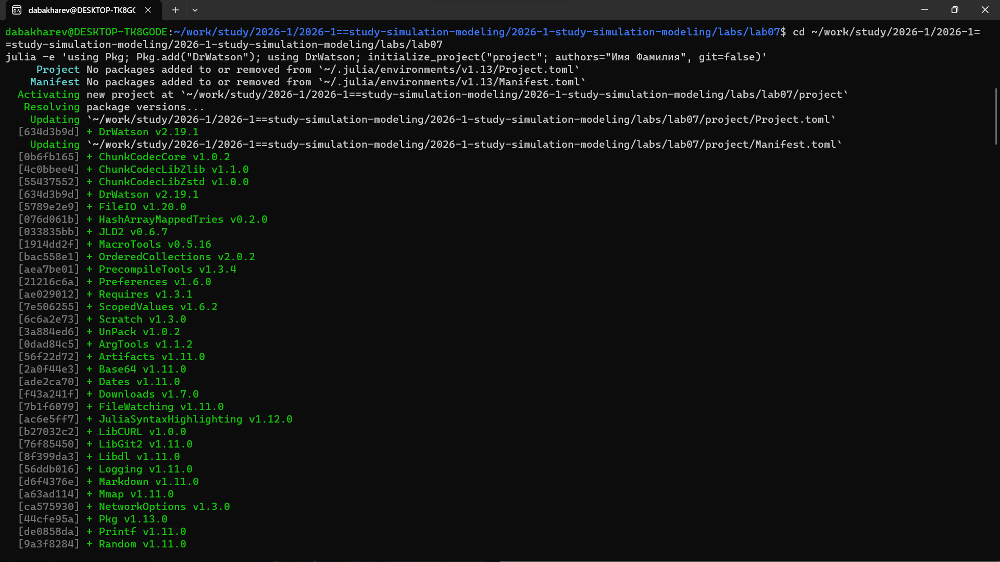
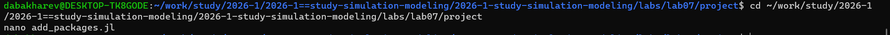
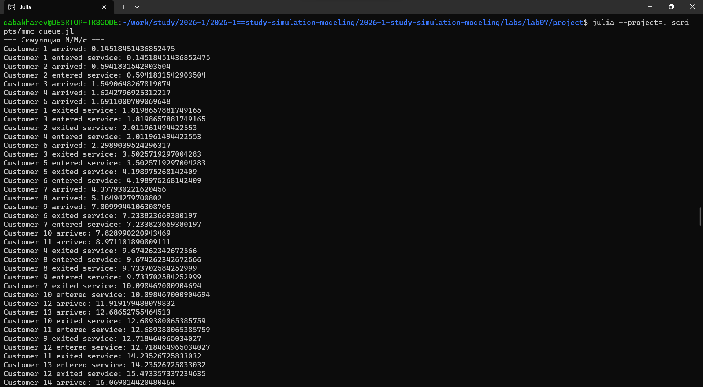
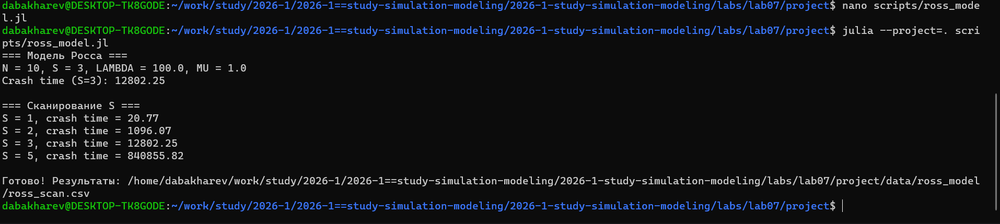
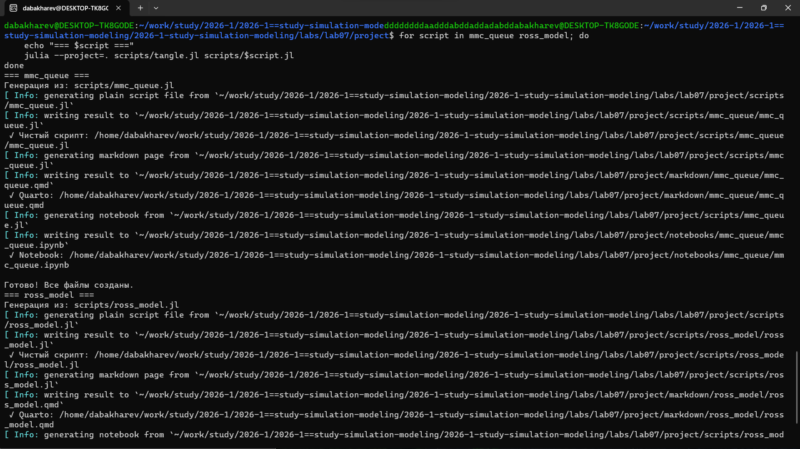
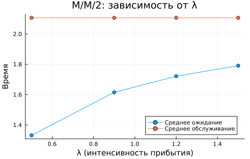
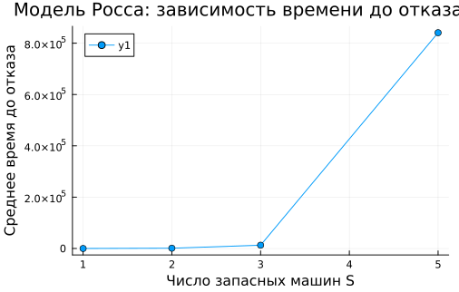

---
## Author
author:
  - name: Бахарев Дмитрий Александрович
    group: НКНбд-01-23
    email: traap.luuvv@mail.ru
    affiliation:
      - name: Российский университет дружбы народов
        country: Российская Федерация
        postal-code: 117198
        city: Москва
        address: ул. Миклухо-Маклая, д. 6
## Title
title: "Отчёт по лабораторной работе №7"
subtitle: "Имитационное моделирование"
license: "CC BY"
---

# Цель работы

Освоить дискретно-событийное моделирование в Julia на примерах
модели M/M/c и модели Росса, провести параметрические исследования.

# Задание

— Создать рабочий каталог для кода.
— Установить необходимые пакеты.
— Выполнить предложенный код.
— Преобразовать код в литературный стиль.
— Сгенерировать из литературного кода:
  — чистый код;
  — jupyter notebook;
  — документацию в формате Quarto.
— Выполнить код из jupyter notebook.
— Интегрировать документацию в формате Quarto в отчёт.
— Добавить в код в литературном стиле вычисление для набора параметров.
— Сгенерировать из литературного кода с параметрами:
  — чистый код;
  — jupyter notebook;
  — документацию в формате Quarto.
— Выполнить код из jupyter notebook с параметрами.
— Интегрировать документацию с параметрами в формате Quarto в отчёт.

# Теоретическое введение

## Модель M/M/c

Система массового обслуживания с $c$ серверами:

- **M** (Markovian) — входящий поток пуассоновский с интенсивностью
  $\lambda$ (интервалы прибытия $\sim \text{Exp}(1/\lambda)$).
- **M** — время обслуживания экспоненциальное с интенсивностью $\mu$
  ($\sim \text{Exp}(1/\mu)$).
- **c** — число параллельных серверов.

Загрузка системы: $\rho = \lambda / (c \mu)$. Условие стационарности
$\rho < 1$.

## Модель Росса

Система с $N$ работающими машинами и $S$ запасными:

- Один ремонтник (обслуживает по одной машине).
- Наработка до отказа одной машины $\sim \text{Exp}(\lambda)$.
- Время ремонта $\sim \text{Exp}(\mu)$.
- При отказе машины одна запасная **немедленно** берётся из резерва.
- Если резерв **пуст** — система **падает** (crash).
- После ремонта машина **возвращается** в резерв.

Требуется найти **среднее время до падения** $E[T]$.

## Дискретно-событийное моделирование

DES (Discrete-Event Simulation) — моделирование систем, состояние
которых меняется **мгновенно** в определённые моменты времени
(«события»). В Julia реализуется пакетом `ConcurrentSim.jl`
через макросы `@resumable` и `@yield`.

# Выполнение лабораторной работы

## Создание рабочего пространства

DrWatson-проект создан в каталоге `labs/lab07/project` (рис. @fig-2).

{#fig-2 width=70%}

## Установка пакетов

Создаю файл `add_packages.jl` для установки пакетов `ConcurrentSim`,
`ResumableFunctions`, `StableRNGs`, `Distributions` (рис. @fig-3).

{#fig-3 width=70%}

Запускаю его — все пакеты устанавливаются успешно (рис. @fig-4).

{#fig-4 width=70%}

## Модель M/M/c

Создаю скрипт `scripts/mmc_queue.jl` с моделью M/M/c
(число серверов $c = 2$, $\lambda = 0.9$, $\mu = 0.5$).
Запускаю его (рис. @fig-5).

{#fig-5 width=70%}

В выводе видны события: `Customer N arrived`, `entered service`,
`exited service`. События обрабатываются **в порядке времени**.

## Модель Росса

Создаю скрипт `scripts/ross_model.jl` для модели Росса
($N = 10$, $S = 3$, $\lambda = 100$, $\mu = 1$). Запускаю его
(рис. @fig-6).

{#fig-6 width=70%}

**Результаты сканирования по $S$:**

| $S$ | Среднее время до отказа |
|---|---|
| 1 | 20.77 |
| 2 | 1096.07 |
| 3 | 12802.25 |
| 5 | 840855.82 |

**Чем больше запасных машин, тем дольше система работает** —
это иллюстрирует важность резервирования.

## Генерация производных форматов

Запускаю `tangle.jl` для скриптов `mmc_queue.jl` и `ross_model.jl`.
Генерируются `.qmd`, `.ipynb` и чистый `.jl` (рис. @fig-7).

{#fig-7 width=70%}

## Результаты M/M/c

График зависимости среднего времени ожидания и обслуживания
от $\lambda$ (рис. @fig-8).

{#fig-8 width=70%}

Видно, что с ростом $\lambda$ среднее время ожидания **растёт**.

## Результаты модели Росса

График зависимости времени до отказа от числа запасных
машин $S$ (рис. @fig-9).

{#fig-9 width=70%}

Кривая **резко возрастает** — экспоненциальная зависимость
от $S$.

## Листинги из Julia





# Заключение

В ходе лабораторной работы №7:

- Освоен пакет **`ConcurrentSim.jl`** для дискретно-событийного
  моделирования.
- Реализована модель **M/M/c** (многоканальная СМО).
- Реализована модель **Росса** (система с резервом и ремонтом).
- Проведены параметрические исследования:
  - для M/M/c — сканирование $\lambda$;
  - для модели Росса — сканирование $S$.
- Показано, что **резервирование** резко увеличивает время
  до отказа системы.
- Сгенерированы `.jl`, `.qmd`, `.ipynb` и собран отчёт.

# Список литературы {.unnumbered}

::: {#refs}
:::
