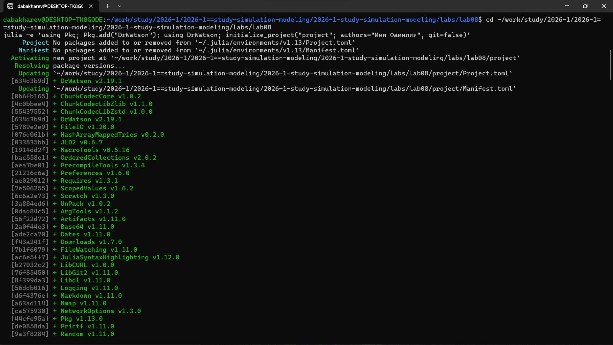
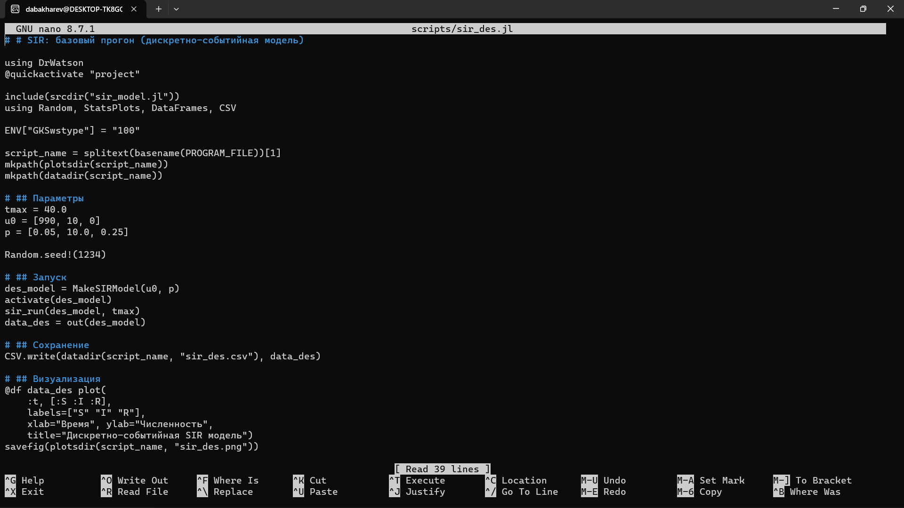
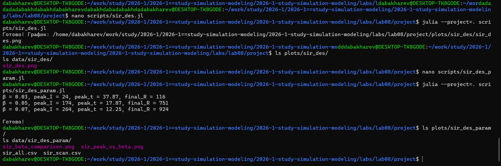
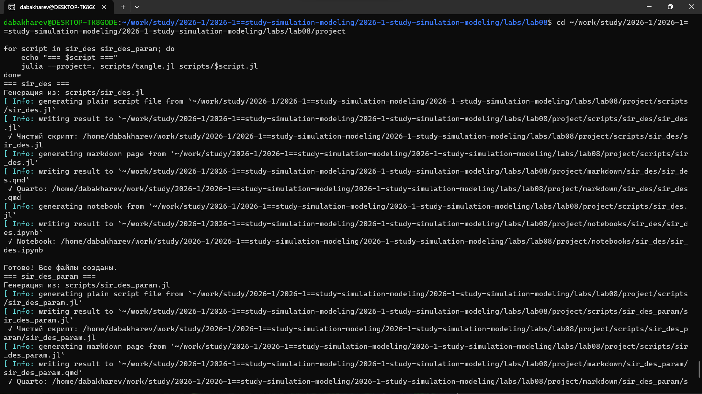
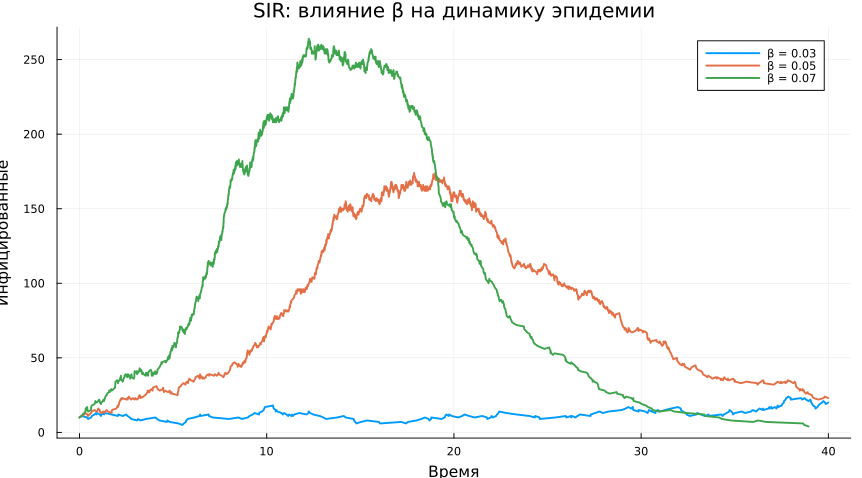
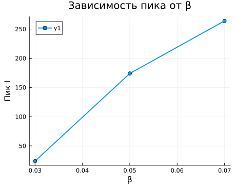

---
## Author
author:
  - name: Бахарев Дмитрий Александрович
    group: НКНбд-01-23
    email: traap.luuvv@mail.ru
    affiliation:
      - name: Российский университет дружбы народов
        country: Российская Федерация
        postal-code: 117198
        city: Москва
        address: ул. Миклухо-Маклая, д. 6
## Title
title: Лабораторная работа №8
subtitle: Модель SIR через дискретно-событийное моделирование
license: CC BY
---

# Введение

## Актуальность

- Модель SIR — классическая модель эпидемиологии.
- Дискретно-событийное моделирование (DES) учитывает
  стохастичность процессов.
- Пакет `ConcurrentSim.jl` реализует DES в Julia.

## Цель и задачи

**Цель:** реализовать модель SIR через DES, провести
базовый эксперимент и параметрическое сканирование.

**Задачи:**

1. Создать DrWatson-проект.
2. Установить пакеты `ConcurrentSim`, `ResumableFunctions`,
   `StableRNGs`, `Distributions`, `StatsPlots`.
3. Реализовать базовую модель `sir_des.jl`.
4. Провести параметрическое исследование по β.
5. Построить графики, собрать отчёт.

# Теоретическая часть

## Модель SIR

$$
\begin{cases}
\dfrac{dS}{dt} = -\beta \dfrac{S I}{N}, \\[6pt]
\dfrac{dI}{dt} = \beta \dfrac{S I}{N} - \gamma I, \\[6pt]
\dfrac{dR}{dt} = \gamma I.
\end{cases}
$$

## Дискретно-событийный подход

События: **заражение** и **выздоровление**. Время между
событиями — экспоненциальное:

- заражение: $\Delta t \sim \text{Exp}(\beta S I / N)$;
- выздоровление: $\Delta t \sim \text{Exp}(\gamma I)$.

# Выполнение работы

## Создание проекта

{width=70%}

## Файл add_packages.jl

{width=70%}

## Установка пакетов

{width=70%}

## Базовый скрипт sir_des.jl

{width=70%}

## Запуск скриптов

{width=70%}

**Результаты сканирования по β:**

| β | Пик I | Время пика | Финальное R |
|---|---|---|---|
| 0.03 | 24 | 37.87 | 116 |
| 0.05 | 174 | 17.87 | 751 |
| 0.07 | 264 | 12.25 | 924 |

## Генерация производных форматов

{width=70%}

## Базовая динамика SIR

{width=70%}

## Сравнение траекторий

{width=70%}

## Зависимость пика от β

{width=70%}

# Результаты

## Ключевые выводы

- **DES** учитывает стохастичность (в отличие от ODE-модели).
- С ростом $\beta$ **пик эпидемии** растёт, а **время пика**
  уменьшается.
- **Конечное $R$** растёт с $\beta$ — больше людей переболевает.

# Заключение

## Итоги

- Освоен пакет `ConcurrentSim.jl` для DES.
- Реализована модель SIR через события заражения/выздоровления.
- Проведены базовый и параметрический эксперименты.
- Сгенерированы `.jl`, `.qmd`, `.ipynb` и собран отчёт.
