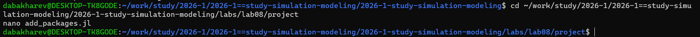
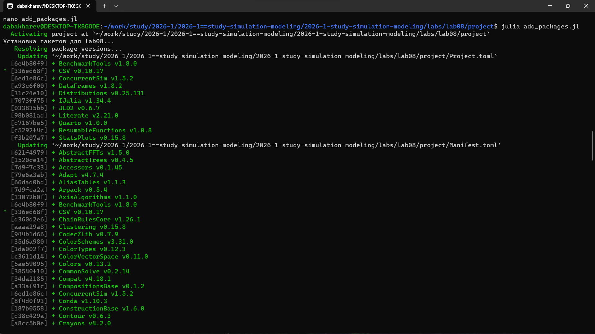
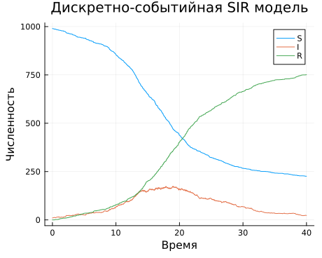

---
## Author
author:
  - name: Бахарев Дмитрий Александрович
    group: НКНбд-01-23
    email: traap.luuvv@mail.ru
    affiliation:
      - name: Российский университет дружбы народов
        country: Российская Федерация
        postal-code: 117198
        city: Москва
        address: ул. Миклухо-Маклая, д. 6
## Title
title: "Отчёт по лабораторной работе №8"
subtitle: "Имитационное моделирование"
license: "CC BY"
---

# Цель работы

Освоить дискретно-событийное моделирование в Julia на примере
модели SIR, реализовать базовую модель и провести параметрическое
исследование.

# Задание

— Создать рабочий каталог для кода.
— Установить необходимые пакеты.
— Выполнить предложенный код.
— Преобразовать код в литературный стиль.
— Сгенерировать из литературного кода:
  — чистый код;
  — jupyter notebook;
  — документацию в формате Quarto.
— Выполнить код из jupyter notebook.
— Интегрировать документацию в формате Quarto в отчёт.
— Добавить в код в литературном стиле вычисление для набора параметров.
— Сгенерировать из литературного кода с параметрами:
  — чистый код;
  — jupyter notebook;
  — документацию в формате Quarto.
— Выполнить код из jupyter notebook с параметрами.
— Интегрировать документацию с параметрами в формате Quarto в отчёт.

# Теоретическое введение

## Модель SIR

Модель SIR делит популяцию на три группы:

- $S$ (Susceptible) — восприимчивые;
- $I$ (Infectious) — инфицированные;
- $R$ (Recovered) — выздоровевшие.

Классическая модель описывается системой ОДУ:

$$
\begin{cases}
\dfrac{dS}{dt} = -\beta \dfrac{S I}{N}, \\[6pt]
\dfrac{dI}{dt} = \beta \dfrac{S I}{N} - \gamma I, \\[6pt]
\dfrac{dR}{dt} = \gamma I.
\end{cases}
$$

## Дискретно-событийное моделирование

В **дискретно-событийном** подходе (DES) состояние системы
меняется **мгновенно** в определённые моменты времени (события):
заражение, выздоровление. Время между событиями моделируется
экспоненциально:

- заражение: $\Delta t \sim \text{Exp}(\beta S I / N)$;
- выздоровление: $\Delta t \sim \text{Exp}(\gamma I)$.

В Julia используется пакет `ConcurrentSim.jl` с макросами
`@resumable` и `@yield`.

# Выполнение лабораторной работы

## Создание рабочего пространства

Проект DrWatson создан в каталоге `labs/lab08/project` (рис. @fig-2).

{#fig-2 width=70%}

## Установка пакетов

Создаю файл `add_packages.jl` для установки пакетов
`ConcurrentSim`, `ResumableFunctions`, `StableRNGs`, `Distributions`,
`StatsPlots` (рис. @fig-3).

{#fig-3 width=70%}

Запускаю установку — все пакеты ставятся успешно (рис. @fig-4).

{#fig-4 width=70%}

## Базовый скрипт sir_des.jl

Создаю скрипт `scripts/sir_des.jl` с базовой моделью SIR
(рис. @fig-5).

{#fig-5 width=70%}

## Запуск скриптов

Запускаю `sir_des.jl` и `sir_des_param.jl`. Первый строит базовый
график `sir_des.png`, второй проводит параметрическое сканирование
по $\beta$ (рис. @fig-6).

{#fig-6 width=70%}

Результаты сканирования:

| $\beta$ | Пик $I$ | Время пика | Финальное $R$ |
|---|---|---|---|
| 0.03 | 24 | 37.87 | 116 |
| 0.05 | 174 | 17.87 | 751 |
| 0.07 | 264 | 12.25 | 924 |

**Видно:** чем больше $\beta$, тем **выше пик** и **раньше** он
наступает; **конечное $R$** тоже растёт.

## Генерация производных форматов

Запускаю `tangle.jl` для обоих скриптов. Генерируются `.qmd`,
`.ipynb` и чистый `.jl` (рис. @fig-7).

{#fig-7 width=70%}

## Результаты базового эксперимента

График динамики SIR для базового случая приведён на рис. @fig-8.

{#fig-8 width=70%}

## Сравнение траекторий при разных β

Сравнительный график `sir_beta_comparison.png` приведён
на рис. @fig-9.

{#fig-9 width=70%}

## Зависимость пика от β

График `sir_peak_vs_beta.png` — зависимость пика $I$ от $\beta$
(рис. @fig-10).

{#fig-10 width=70%}

## Листинги из Julia





# Заключение

В ходе лабораторной работы №8:

- Освоен пакет **`ConcurrentSim.jl`** для дискретно-событийного
  моделирования.
- Реализована модель **SIR** через DES: события — заражение и
  выздоровление.
- Проведён **базовый эксперимент** (один прогон) и
  **параметрическое сканирование** по $\beta$.
- Показано, что с ростом $\beta$ **пик эпидемии** растёт, а
  **время пика** уменьшается.
- Сгенерированы `.jl`, `.qmd`, `.ipynb` и собран отчёт.

# Список литературы {.unnumbered}

::: {#refs}
:::
